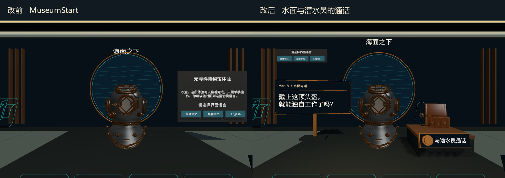

# 中央展台水面通话样板的独立验收

通过独立样板验收。访客在电话座松开铜键，水面先发出“潜水员，收到吗？”，随后头盔旁回答“收到，水面。”两句对白分别出现在说话的一端。原版与样板在同一机位取景。[同机位对照与连续画面](review.html)可在本地浏览器中打开。

## 审查与复验

- 第一版的背景重复露出半句提问，电话听筒又与语言牌重叠。复核后的样板在开场只显示一次提问，三语入口完整可见，呼叫键和电话位于同一底座。低眼位的旧操作排仍较抢眼。
- Codex 审查对话以独立副本复跑 Windows 上的 Unity 2022.3.62f3c1，核对最终受测提交 `a3fb217a` 的 1,344 个工程文件，字节差异为零。原场景与样板均自然退出 0，两次开场眼位一致。操作段眼高 1.25 米，使用静音和模拟右手的 XRI 射线。[原场景记录](baseline-observation.txt) · [样板输入与状态记录](sample-observation.txt)
- 按住后移开可以取消，按住时保持待机，在原键松开确认一次。随后出现水面发问、等待和潜水员回话。已复核简体、繁体、英文及减少动画模式。[连续操作实录](../20261118-surface-call-a3fb217/surface-call.mp4)
- 真实头显双眼阅读、手柄触达、舒适度和初访者能否自主发现这段互动，仍待现场观察。设计、制作与本次复核使用了 Codex。完整进入步骤和设计选择见[样板交接](../../../../../docs/activity/2026-11-18-creative-opening.md)。
