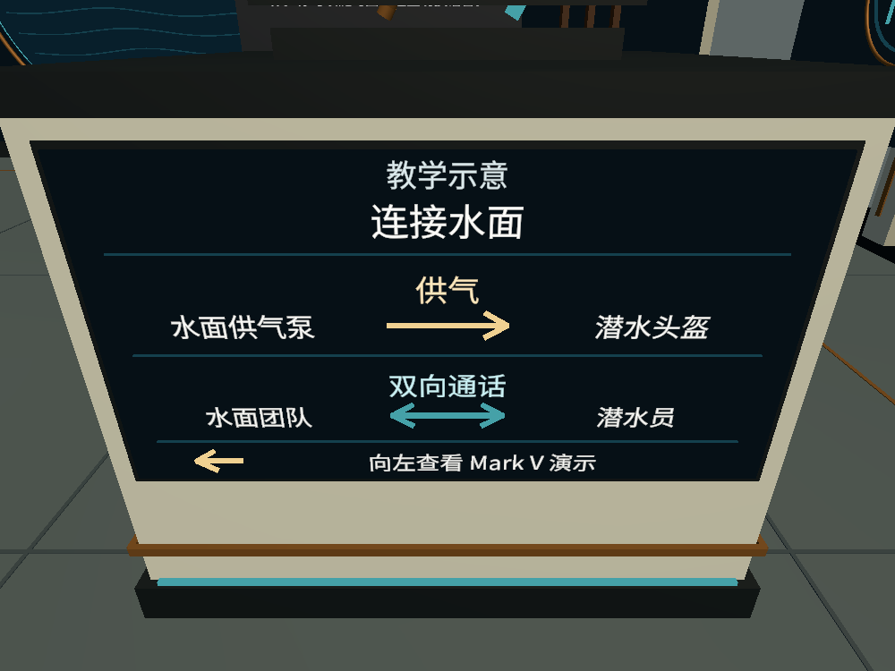
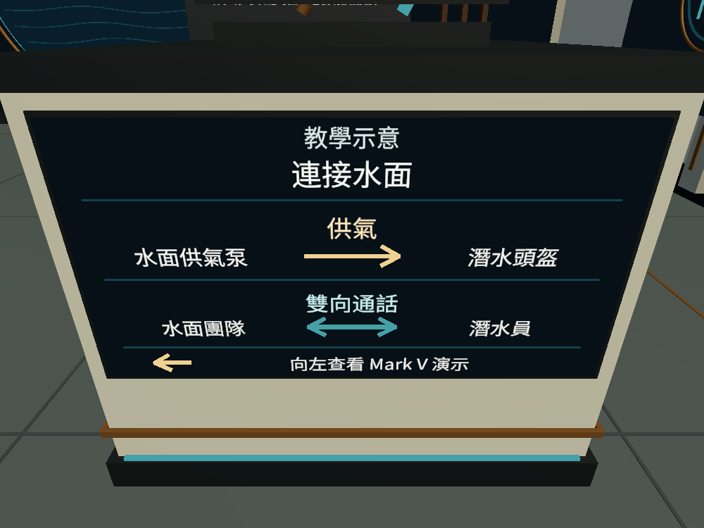
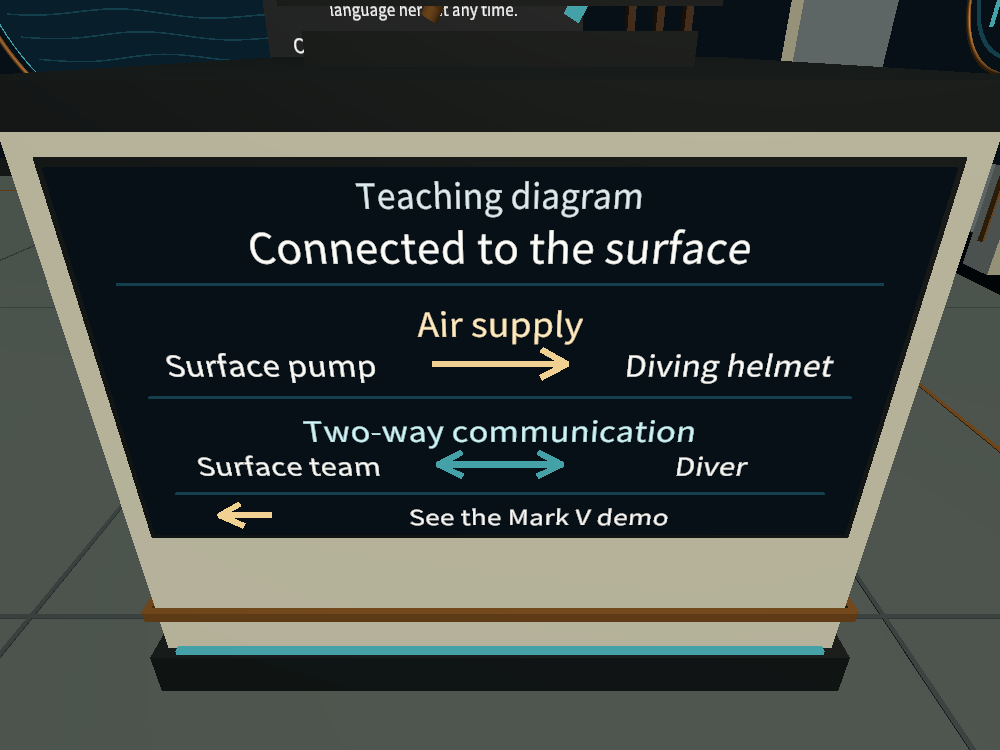
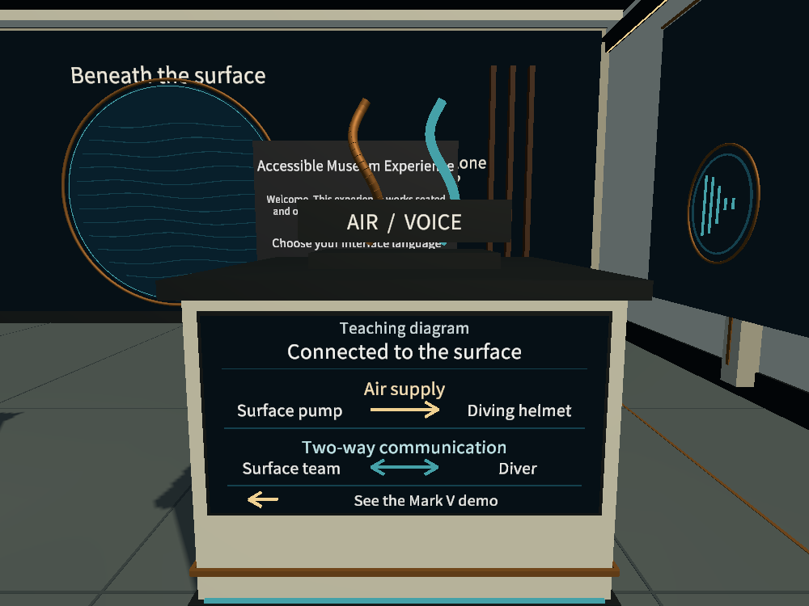

# #77 右侧展台接入验证

被测源码：`5c8e35e05f41332aba42695df425493d4095f6f1`；开始时工作区干净。基线为 `5ddaab5`。后续记录提交不修改工程文件。

环境：macOS / Apple M5 / Metal / Rosetta，Unity **2022.3.62f3c1**。这是桌面编辑器自动验证与诊断单眼渲染。

| 检查 | 结果 | 证据 |
| --- | --- | --- |
| 保存场景展板、预制件来源、唯一实例、旧标签禁用、三语、字形、间距、四个坐姿诊断眼位、箭头、碰撞与通路 | 1,102 项通过，进程自然退出 0 | [完整检查](right-exhibit-report.txt) |
| 三年代切换、提示点和 Mark V 供气／通话入口 | 1,132 项通过，0 项检查错误／警告，进程自然退出 0 | [原始报告](visitor-era-report.json) |
| 测试后工程文件 | 1,446 文件 SHA-256 零差 | [运行清单](run.json) |
| LFS | 111 路径实体已展开，SHA-256 与指针一致；本次没有修改 LFS 资产 | [运行清单](run.json) |

## 三语效果









截图使用临时诊断相机，没有改动产品相机或保存测试位姿。四个眼位为工程布局夹具，不是参与者测试。年代原始报告中的 49 张截图和完整进程日志保留于本地验证输出，本次只提交与展板审阅直接相关的四张图。

## 复跑

先关闭这个工程的图形编辑器。使用同一版本 Unity，有 GPU，不加 `-nographics`。两个入口自行退出，不加 `-quit`。为每次运行指定新的输出目录。

```sh
"$UNITY_EDITOR" -batchmode -force-metal -projectPath "$PROJECT_PATH" \
  -executeMethod Museum.RightExhibit.Editor.RightExhibitPanelValidation.RunBatch \
  -rightExhibitOutput "$NEW_OUTPUT/panel" -logFile "$NEW_OUTPUT/panel.log"

MUSEUM_QA_OUTPUT="$NEW_OUTPUT/era" "$UNITY_EDITOR" -batchmode -force-metal \
  -projectPath "$PROJECT_PATH" \
  -executeMethod Museum.Localization.EditorTools.VisitorEraValidation.RunBatch \
  -logFile "$NEW_OUTPUT/era.log"
```

`UNITY_EDITOR` 指向 Unity 可执行文件，`PROJECT_PATH` 指向仓库的 `MuseumVR`，`NEW_OUTPUT` 为仓库外的新目录。Windows 目标设备复跑时用其平台的图形后端替换 `-force-metal`，本轮没有执行 Windows 复跑。

## 限制和首次失败

首轮 `cb07efa` 的来源检查放在 Play Mode，因运行时对象没有可查询的编辑器预制件来源而退出 1。修订为在 Edit Mode 读取来源、跨域保留后，再检查运行时实例。最终验证保持“场景缺少展板就失败”，不会先临时挂载来掩盖遗漏。首次失败报告和日志保留本地。

Unity 日志包含无头显环境下的 OpenXR runtime unavailable 信息；不据此宣称已连接设备。源码重编译曾显示两个既有的 `XRBaseInteractable.IsSelectableBy` 弃用警告。本轮未进行真实头显／双眼、控制器触达与舒适度、性能、Windows Player 构建或用户研究。
