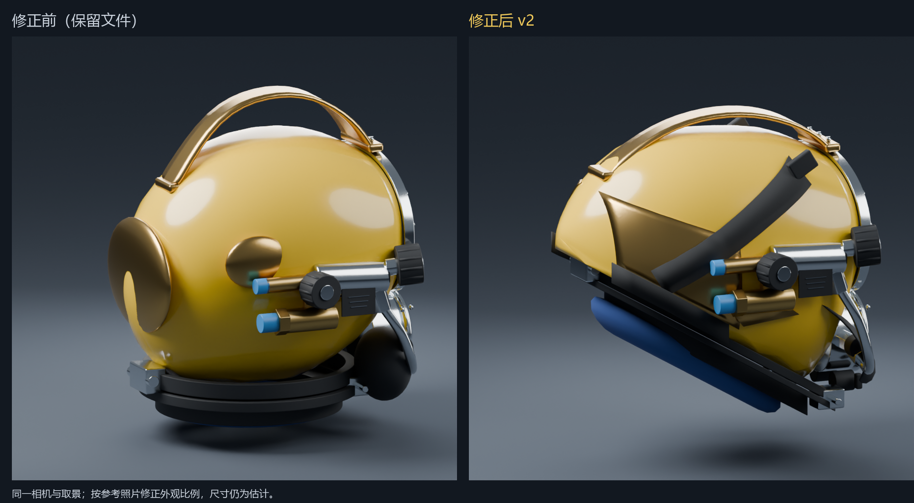

# SuperLite 17B：侧面比例修正版 v2

根据用户提供的 `04_side_rear_view.png` 与 Blender 截图，修正第一版过圆的壳体、水平叠圈式颈部、球状黄铜配重和过高的提手。交付为独立 [superlite17b.blend](delivery/superlite17b.blend)，原文件保留。本版用于继续审阅外观，尚未接入 Unity。

对比图来自本轮开工时实际保留的旧文件与实际保存的 v2，使用相同正交相机、位置、朝向、画幅。沿用各自文件的材质和灯光；图片是外观比较，不能用作照片测量或相机标定。

## 外形修正

| 问题 | v2 改动 |
| --- | --- |
| 侧面像球体，后壳短，前下方不够深 | 延长后壳轮廓，调整顶部长弧和后端收口，加深前部下颏区域 |
| 颈部为水平粗叠圈 | 壳体开口、颈圈、底部软垫统一采用斜面；减薄夹圈，后下缘向上收起 |
| 后配重呈金色球状凸包 | 改为左右两块贴壳薄弧面，侧阀下的小支架改为薄片 |
| 头带窄、折线明显 | 改为连续宽带，投射贴合壳体，并补上后侧颈圈固定带 |
| 提手高拱、壳顶留空过大 | 降低拱高并调整后脚；模型顶隙由约 39.2 mm 减至 16.7 mm |
| 侧阀相对壳体偏低 | 阀体、两组接口、旋钮与小件一起上移，管路端部同步连接 |
| 排气罩像椭圆块 | 改为薄、外展的曲面裙边；后部蓝垫改为沿斜口的圆滑中空形态 |

照片中可观察到上述外形关系，但它不是带尺度的正交测绘图。模型采用约 30.1° 的颈圈斜面来改善其相对前窗的关系，这个角度、所有米数和零件厚度均为建模假设，不是厂家实测参数。隐藏结构、配重边缘圆角、织带纹理和细部接合仍属展示近似。

## 保存文件与检查

Blender 4.5.14 LTS；模型使用米、前方 -Y、上方 +Z。143 个模型网格、50,268 三角面，排除摄影棚网格后的包围盒为宽 0.281666 m × 深 0.325009 m × 高 0.313847 m。包围盒只描述生成结果。

- 已输出六个阶段，每阶段五视图，共 30 张图片；[终稿参考角度](delivery/renders/stage6_reference_side_rear.png)、[侧面](delivery/renders/stage6_side.png)、[正面](delivery/renders/stage6_front.png)、[顶部](delivery/renders/stage6_top.png)、[斜前方](delivery/renders/stage6_threequarter.png)。保存文件默认相机为参考侧后角度。
- 新 Blender 进程回读终稿，UV、有限坐标、零面积面、壳体封闭性、已应用修改器、透明镜片、固定件数量、面数预算通过；与相同脚本另一次草稿构建的逐对象几何哈希一致。见[源文件回读](../../../helmet-interaction/qa/runs/2026-10-11-superlite17b-profile-v2/source-readback.json)。
- 专项检查通过：斜圈平面与指定角度一致，圈的竖直带厚约 10.3 mm，两块后配重最大距壳约 1.72 mm，提手顶隙约 16.7 mm，后固定带存在。见[比例改动检查](../../../helmet-interaction/qa/runs/2026-10-11-superlite17b-profile-v2/side-profile.json)。这些检查验证改动已保存，不证明实物比例准确。
- 同一专项检查用于保留旧文件时，五项均不通过，符合该文件尚无此次修正的情况。见[旧文件回归对照](../../../helmet-interaction/qa/runs/2026-10-11-superlite17b-profile-v2/retained-v1-regression.json)；此报告不代表旧模型的总体质量验收。
- 人工式视觉检查由 Codex 查看实际输出的侧后、侧、正、顶视图与同机位前后对比；不能代替用户或团队审阅。

v2 文件 SHA256：`54a21895b807a19ccc0345a25101cb5369c0a9c976d175a40a58a528a5b8b905`。本轮保存前后旧文件 SHA256 均为 `5bf1c30e1f8b848745e76e95111d407da110a80936484e920ee248d0154ca841`。参考照片、用户截图、脚本与模型哈希见 [provenance.json](provenance.json)。原照片仅在本地查看，没有复制入交付或用作贴图。

没有导出 FBX/GLB、修改 Unity 资产、运行 Unity、测试真实头显/性能或可执行构建；这些内容不在本次比例修正范围。没有覆盖已有原型、面窗/侧阀研究件、旧报告或用户保存的第一版。接入 XR 前仍需要确定真实尺度并执行引擎导出与导入验证。
