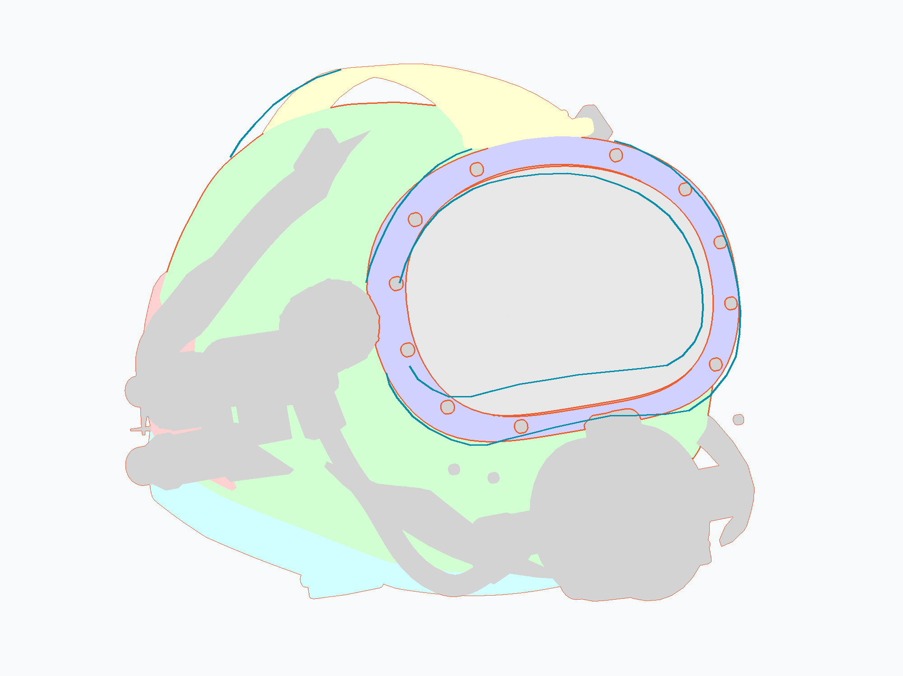
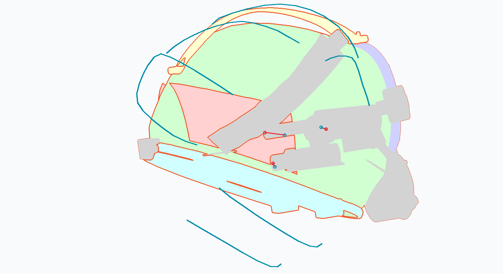

# v4 相机匹配与误差基线：r1

产品/研究源为冻结的 v4，SHA256 `6e85f7f048b3a6b8706428854ab8934099da25ff21d427e87fde9de930b1c8a2`。本轮执行计划步骤1–3：原图标注、透视匹配候选、实际可见模型边界及相机敏感性。**尚未生成新的几何修订。**

## 结论与接下来改哪里

1. **后配重是本次认领范围内优先项，但不能只贴壳描图。** 侧后照两段可见边界到主候选下模型可见边界的中位距离约48/68像素，标注保守量为5/6像素；近侧配重在保留候选中的位置变化也要计算，不能将这两数当精确3D差。沿20个折线采样条目（19个不同像素）检查，候选下只有8–9条命中现有壳体。该结果否定“在现有壳面上投影照片边缘就能修好”这个简单方法；不能据此断言真实配重每个边缘必须有壳体支承，也不能直接把壳体拉到照片边缘。
2. **前窗外缘在所选主候选下较接近，内部开口仍需复核。** 前图主拟合只使用可见压圈外缘。实际模型可见外边界中位距离约6–8像素；未参与拟合的较长玻璃边界段约27像素，且可能混有玻璃/密封层边界定义差异。先核实边界身份，再考虑修改；此项不顺带修改本轮后部以外的前窗。
3. **相机与附件位置仍未闭合，整体壳体形变暂缓。** 侧图的上蓝帽端面约62像素残差，另两个约12/18像素；不能把被鲁棒损失减弱的点写成“已正确匹配”。前图在相近拟合代价下，后配重投影仍可相差数百像素。侧图最优焦距剖面在本次最大值处，内参仍不唯一。继续按计划的停做条件保留全壳几何；下阶段的后部结构研究只能按厂家连接依据独立进行，估算坐标与形状要保持明确。

以上为固定 v4 的投影诊断，不是改模后提升，更不是毫米精度或设备结果。旧45/60像素使用了不同的对应点，不能与本次曲线距离相减当作精度提升。

## 查看

橙色为当前 v4 的可见几何边界，青色为参考照片的人工描线；浅色块只是本项目模型的覆盖范围。只比较明确可见的曲线段。玻璃在覆盖图中暂按不透明几何处理，不能拿它判断透光或真实材质。

| 前侧参考对应的模型诊断 | 侧后参考对应的模型诊断 |
| --- | --- |
|  |  |

这两张提交图片不含厂家原图像素。含原照片的本地叠图保存在原作者工作副本 `tmp/sl17b-v4-camera/local-previews/`，不随clone分发。拥有原资料者可用下方命令重新生成；原图来自[已有输入清单](../reference-inventory.json)，不是本轮新增图片或贴图。

## 证据与方法边界

- [前图标注](annotations-front.json)、[侧图标注](annotations-side.json)：分别保留两遍同一AI顺序重读，坐标与原图哈希绑定。它们不是独立人类标注或用户研究。紧固件未自动映射到11枚模型螺钉；遮挡处未补造。
- [相机剖面](results/camera-fit.json)：每图5个固定虚拟焦距、两遍标注；每个剖面9个姿态初值，保留候选。原模型保持不变；焦距以像宽倍数和像素表示，不称原相机焦距。
- [实际边界指标](results/baseline-metrics.json)：从Blender真实遮挡后的几何覆盖图提边界，按折线路径每约6像素采样；样本数不是独立测试用例。距离以像素与参考图宽百分比记录，没有可闭合的完整实物轮廓，因此未报告IoU。
- [渲染投影核对](results/render-checks.json)：同一相机下，数值投影与Blender投影误差小于0.002像素。该检查只证明坐标/渲染一致，不证明实物正确。
- [壳面支承检查](results/shell-support.json)：只测试相机射线是否命中当前模型，不恢复真实接触位置。两个折线共享端点，20条采样只有19个不同像素，也不是19个独立观测。
- 候选敏感性集合采用“同一标注遍次、代价不超过主候选1.25倍”的启发规则，不是统计置信区间。两张产品照片不保证同一件、同配置；不同部件照片之间不强行共享相机或比例。

## 复跑

Windows / Blender4.5.14 LTS / Python3.12 / NumPy / SciPy1.18.1 / Pillow。本次SciPy只安装到本地忽略目录，未改Unity或全局环境。相机拟合采用SciPy `least_squares` 的有界soft-L1最小二乘，方法见[官方文档](https://docs.scipy.org/doc/scipy/reference/generated/scipy.optimize.least_squares.html)。

先在新的独立输出目录运行，保护本轮已引用证据。`<stage>` 为本README所在目录，`<geometry>`、`<fit-run>`、`<render-run>`、`<analysis-run>`和`<private-preview>`取新路径，原图根目录由本机资料位置指定。

```text
<Blender> --background --disable-autoexec --python-exit-code 1 --python <stage>/export_projection_geometry.py -- --output <geometry>
<Python-with-scipy> <stage>/fit_projection.py --geometry <geometry> --output <fit-run>
<Blender> --background --disable-autoexec --python-exit-code 1 --python <stage>/render_projection_masks.py -- --cameras <fit-run>/camera-fit.json --output <render-run>
<Python-with-scipy> <stage>/analyze_baseline.py --fit <fit-run>/camera-fit.json --renders <render-run> --geometry <geometry> --reference-root <原图refs目录> --output <analysis-run> --local-previews <private-preview>
<Blender> --background --disable-autoexec --python-exit-code 1 --python <stage>/check_shell_support.py -- --cameras <fit-run>/camera-fit.json --output <analysis-run>/shell-support.json
```

脚本不保存源blend。导出几何只为计算，原始数组和故障日志留本地；正式交付保留可再生成脚本、参数、标注及有用诊断。
