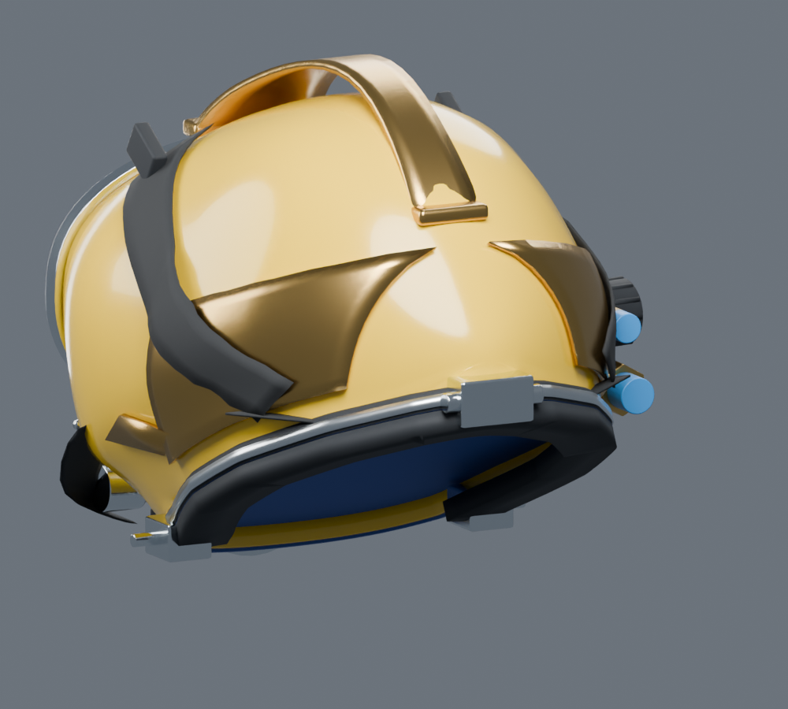
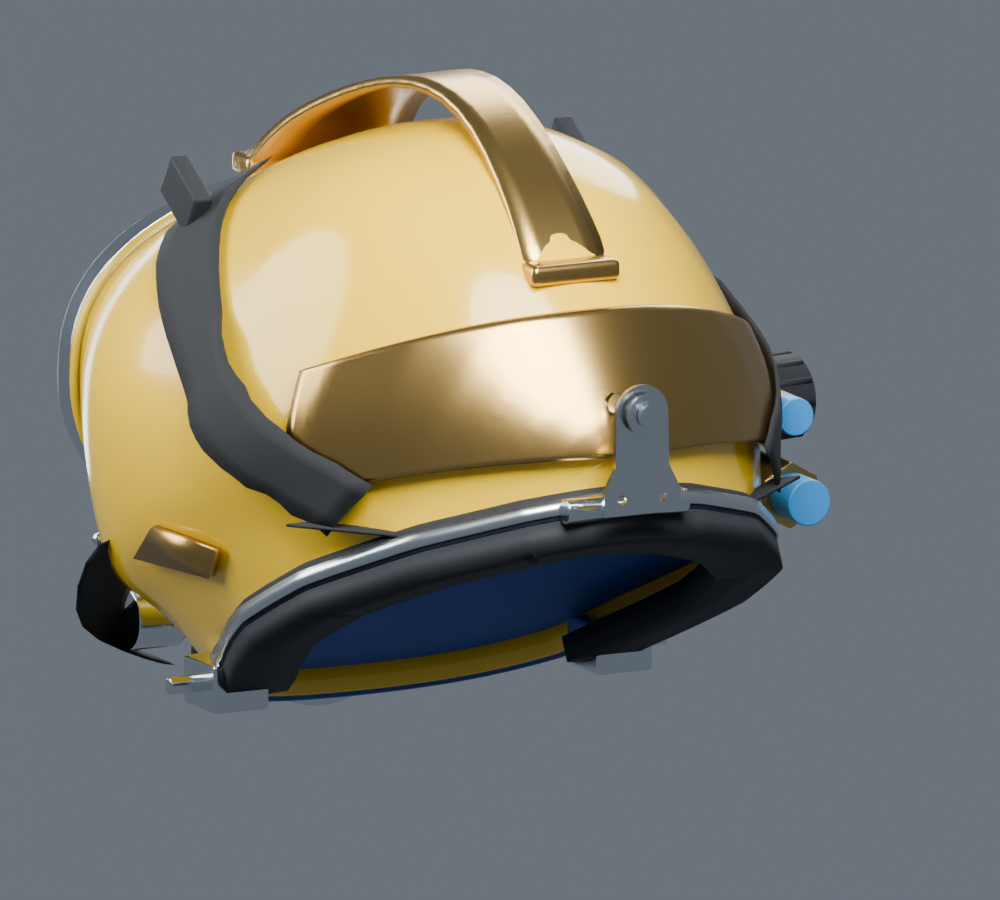
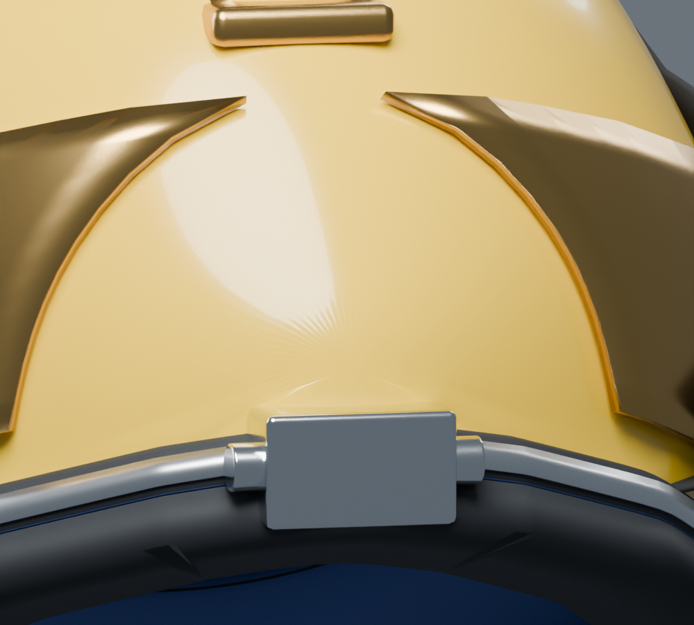
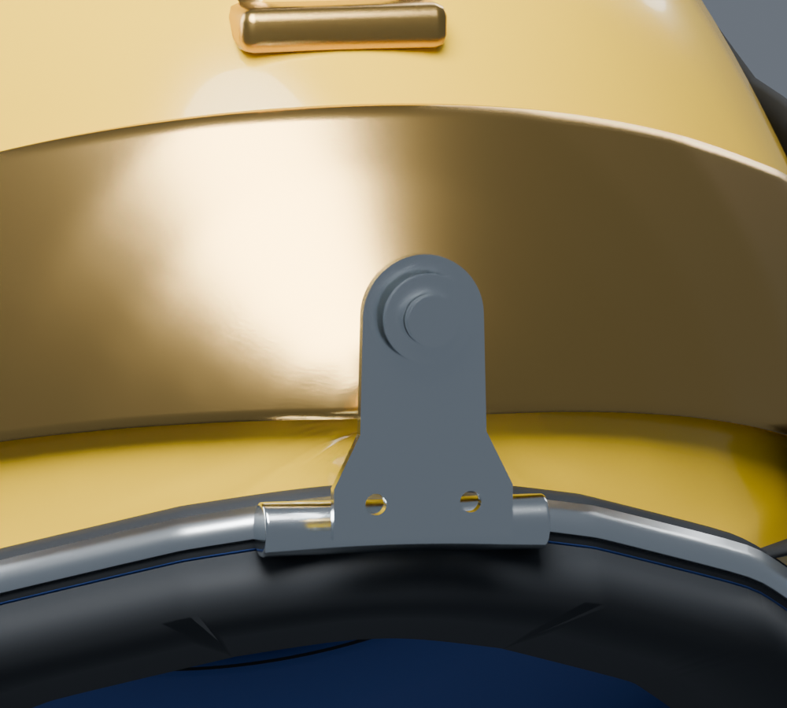
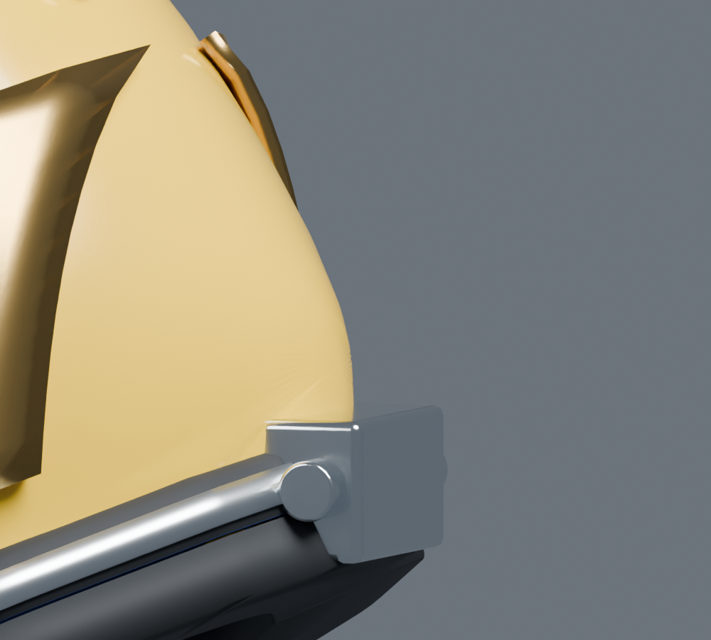
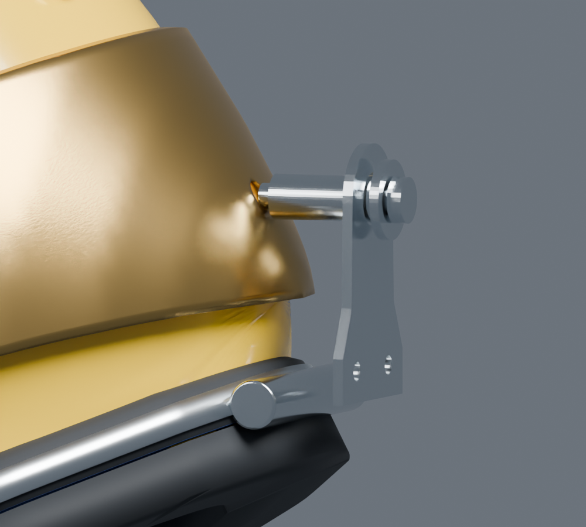

# v4 后部连接研究样件 r1

本件是按 #25 认领范围从用户选定 v4 另存的**独立结构研究样件**，不是已经验收的产品替换版。先完成[相机与误差基线](../camera-baseline-r1/README.md)，按歧义停做条件保留整盔壳体；只研究有厂家结构依据的后配重、定位套筒和后铰片。**挂片下端与保留横销尚未对齐；没有证明照片轮廓精度提高。**

[打开可编辑源](../sources/superlite17b-rear-study-r1.blend) · [本轮参数与来源指纹](../sources/superlite17b-rear-study-r1.json) · [实际保存源检查](../../../helmet-interaction/qa/runs/20261112-superlite-rear-r1-structural/report.json)

## 改动与依据

- 两片旧后配重被一个连续后侧研究件替代，中心形成定位套筒的研究座。依据[整盔图 #241108001](https://www.kirbymorgan.com/sites/default/files/2025-01/sl-17b-blowapart-241108001.pdf)后配重身份及[颈夹手册 #260319004](https://www.kirbymorgan.com/sites/default/files/2026-03/superlite-17b-neck-clamp-area-including-internal-chin-strap-and-yoke-260319004.pdf)17BNK-5–7的后配重挂接关系；新轮廓不是从不唯一相机反算出来的真实边界。
- 新增外端带凸缘的550-339套筒、示意530-090固定螺钉，替换原矩形后铰块为有独立套筒开孔的540-157单片式研究形态。[厂家公告 #06/2006](https://www.kirbymorgan.com/bulletin/bulletin-06-2006)支持现代单片身份，不提供本模型厚度、孔距或真实生产批次。
- 保留原 `Hinge_Pin`，与套筒挂接区分为两个连接背景。下端固定孔、横销及夹圈的实际对应尚未完成，不能称完整机构或真实装配。
- 壳体、前窗、已修颈口共同周线、510-446、连续颈套、U形轭、侧阀和其他141个原对象保持原几何/拓扑、世界变换和UV。已有材质节点输入默认值也相同；新配重沿用原材质，新金属件沿用原金属材质。

## 同机位对照

| 原 v4 | 独立研究 r1 |
| --- | --- |
|  |  |
|  |  |
|  |  |

图片来自真实保存源重开后渲染，同组使用相同相机、画幅、既有灯光/材质。只说明几何变化，不是厂家对照、Unity或实机证据。侧向细节专门保留未闭合接口的可见性。

## 实际检查

研究源共146个模型网格、69,056个三角面；基准v4为144/61,400。增加集中在连续配重和可辨的后部研究件，目前未做运行时简化或性能验收。

- 重开源后141个保留对象的顶点/拓扑、世界变换、UV指纹相同；材质节点输入默认值相同。基准与研究源读取前后SHA不变。
- 5个新/替换研究网格均为单一连通闭合表面，有UV、有限坐标，无零面积三角面，非相邻三角自交检查为0。
- 新件×141保留件共705组BVH三角表面检查无交叠。这个数量是部件配对数，不是705种交互行为，也不能排除完全包含或证明真实机械接触正确。
- 新件彼此10组单列：除示意同一螺钉的头/杆网格连接有64对表面交叠（明确允许的同件建模接合）外，其余表面交叠为0。套筒与配重座交叠问题已修正，不把未检查的新件关系隐去。
- 挂片下端与原横销的Y包围范围相隔约 **8.783 mm（模型坐标）**。新增套筒座留约0.4mm建模间隙；这些不是实物间隙/装配公差，**下端接口仍待下一步核对**。

## 估算和未完成项

新配重覆盖角、上/下边界、厚度、套筒长度/直径、挂片形状、孔位和安装坐标全部为展示研究估算。配重下缘及覆盖范围为避开保留颈套和侧阀而调整，没有以“通过穿插检查”反证实物轮廓准确。没有补造通信柱位置；没有修改整壳来追照片。

试作中出现过连接片自交、配重与壳体/颈套/侧阀、套筒与配重座交叠；失败候选和日志留本地。最终保留完整相同断言重新核对，不删除保护约束来使其通过。本件只交几何可审阅首版，未解决下端挂接位置、真实尺度和形状误差，未导出FBX/GLB或接入Unity，也无头显、性能、承压/水密或人体适配结果。

下一步先依据同配置后部局部资料或人工模型审阅核对挂片下端和横销/夹圈关系，再决定如何调整；不得靠把U轭或颈套整体挪开来隐藏间隔。暂不用于覆盖主线模型。

## 复现

`build_rear_study.py`是本轮针对冻结v4的增量研究脚本，不是历史原型生成器。拒绝覆盖已有输出；只修改明列3个旧对象，并另存新源。执行时使用全新输出路径，不在原v4或本次已交付源上重建。

```text
<Blender4.5.14> --background --disable-autoexec --python-exit-code 1 --python artifacts/helmet-modeling/superlite17b-2026-11-12/build_rear_study.py -- --output <全新目录>/superlite17b-rear-study-r1.blend
<Blender4.5.14> --background --disable-autoexec --python-exit-code 1 --python artifacts/helmet-modeling/superlite17b-2026-11-12/check_rear_study.py -- --study <保存源> --output <独立QA目录>
<Blender4.5.14> --background --disable-autoexec --python-exit-code 1 --python artifacts/helmet-modeling/superlite17b-2026-11-12/render_rear_study.py -- --study <保存源> --output <新渲染目录>
```

已有可编辑源通过LFS交付，保留原v4及前轮历史源。首版等待成员外观/接口反馈；Codex几何检查和AI审阅不代表成员人工批准。
