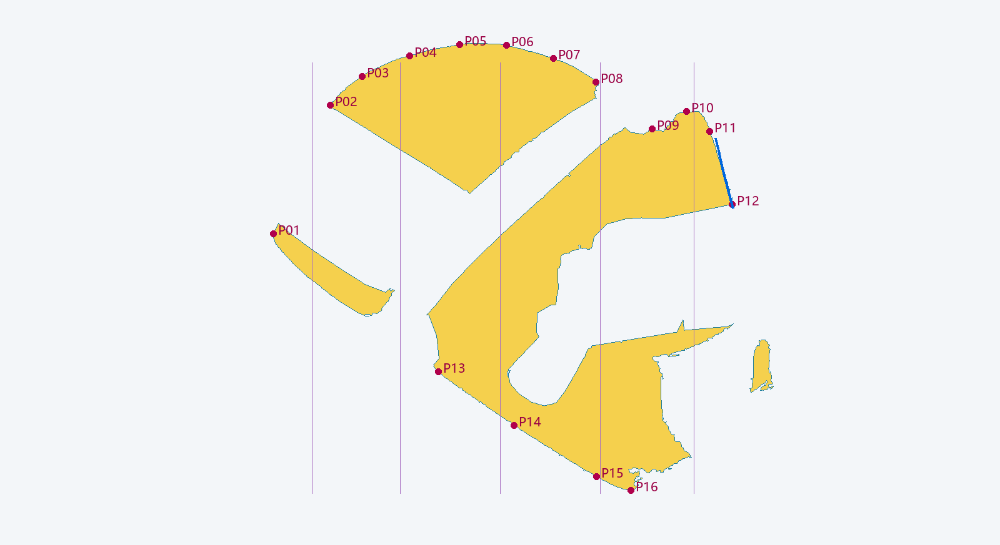

# r3：完整备份、mask基线与16点待确认

本轮按用户新指定的步骤0–3执行。**步骤4的新壳放样、步骤5的10–15件重新贴合尚未开始**，因为用户明确要求先确认16个侧视关键点和窗框倾角。r3将从新的S1–S5截面放样重建，不采用旧壳整体推拉或微调来充当完成。

## 0．已先备份

- [backup_r1_current.blend](backups/backup_r1_current.blend)：按用户指定文件名保存的**当前完整r2模型**，不是把旧r1重新标成当前。逐字节复制，SHA256 `a595dc7f9979d21c95419fcc80fb2619099afcaf2e9735e8676c47037d1aa894`，已设只读。源r1/r2均保留。
- [work_r3.blend](work/work_r3.blend)：单独可写副本，当前与备份完全相同。确认前未改变任何零件或外壳形状。
- 真实重开备份确认146个模型网格、12个材质、1台相机和4盏灯。完整blend含152个场景对象（另含摄影棚背景等），不是只导出头盔网格。[备份来源](backup-manifest.json) · [库存及固定相机](baseline/baseline-cameras-and-inventory.json)

基准三视：[base_side](baseline/base_side.png)、[base_34](baseline/base_34.png)、[base_front](baseline/base_front.png)。前两视角沿用已保存的虚拟透视候选并冻结；侧向相机约偏离纯侧17°、俯仰3°且画面有约8°滚转，属于视角估计，不是真实摄影标定。正前视是模型诊断，未提供独立的实物正前照，不能拿A的3/4照片冒充正前视参考。

## 1．从干净B图提取可见黄壳

[参考B可见黄壳mask](reference-side-visible-mask.png)采用原始 `04_side_rear_view.png`，不从带红/蓝/绿线的附件图抠色。颜色种子与连通域结合明确的硬件排除区；配重、顶梁、阀体、织带、橡胶和金属脚排除，壳面印刷标识按表面保留。小孔区域由规则共恢复377像素，具体阈值/种子/人工polygon和重放代码全部在[分割记录](segmentation-side-r3.json)，不是纯自动摄影测量。

mask白色191,223像素。主/宽阈值mask相互IoU约0.985、相差2912像素，仅作分割敏感性诊断。没有把硬件后隐藏的壳体补成实测面。

**与手绘标注不同之处**：B红线后段实际沿金属后配重；绿线一段穿过织带遮挡。这些不能作为“真实黄色壳体边”。当前16点是可辨黄壳外边/接合边和遮挡终点，不是完整闭合的实体侧轮廓。隐藏轮廓和截面背侧将来仍需明确标“视觉推测”。

## 2．冻结的量化基线

下表比较干净B的**可见黄壳mask**与备份版同相机、被附件遮挡后的可见黄壳mask。既包含壳形差，也受附件/遮挡位置差影响，不能等同完整壳体外形IoU。另存的`*_shell_full.png`是模型隐藏全部附件后的完整几何投影，不与可见参考mask混算。

| 指标 | 当前备份基线 | 用户要求的重建后门槛 |
| --- | --- | --- |
| 可见黄壳 IoU | **0.370253** | ≥0.93 |
| 对称平均边界距离 | **30.643 px = 3.8256% L** | ≤1.5% L |
| 新版/备份壳体mask差异 | **未渲染新版；work与备份同字节，推定0%** | ≥5% |
| B局部窗座边的投影角 | **13.95° ±约5°，待确认** | 新版与确认目标差≤3° |
| 备份版窗平面内竖直线的投影角 | 约7.86°；与参考短边不是同一几何特征 | 不是已通过的平面匹配 |

距离定义：取参考/模型可见mask各自边界到另一边界的最近距离，分别求均值再等权平均。像素差异固定为隐藏所有附件后的**完整壳体几何投影**`XOR(backup,new)/Union(backup,new)`比值，避免整张白背景稀释。未来重建后以同视角无遮挡完整壳体mask计算5%门槛，不计附件重贴合、颜色或材质变化。当前没有新版，不能把0%填为迭代通过。

归一化暂定：参考可见黄壳像素范围x=436…1237，故 **L=801px**，原点`(436,786)`，x向右、y向上。它是**可见投影范围**，并非遮挡后完整壳体的前后总长；与用户草图蓝色L示意并非同一定义。完整壳体外廓被配重/织带/前部件挡住，当前不能无依据闭合后称实测IoU。此口径也请在第3步确认，未确认前不会用它替代最终验收定义。[完整数值和公式](baseline-metrics.json)

附件遮挡必须与壳体外形分开解释：当前相机/硬件覆盖下，参考黄壳约34.67%落在模型硬件前景区。若继续固定这些遮挡并要求壳体保持在硬件后，则可见mask IoU的条件上界约0.653；这不是重建后重新贴合附件的上界，也不是降低0.93门槛的理由。后续应同时记录无遮挡壳体变化和真实可见mask，避免通过移动硬件或让壳体穿件来“刷”IoU。

## 3．16点和倾角，请先确认



图中浅黄为参考可见mask，紫点为候选侧视约束，竖线仅沿用户S1–S5草图像素位置标示讨论；不能直接当已求出的3D截面。遮挡处不连线、不闭合。蓝段为用于估计投影角的窗座局部边。

| 点 | 原图像素 (u,v) | 归一化 (x,y向上)，L=1 | 部位 |
| --- | --- | --- | --- |
| P01 | 437,374 | 0.0012,0.5144 | 后配重下露出黄壳 |
| P02 | 528,168 | 0.1149,0.7715 | 冠顶可见弧后端 |
| P03 | 579,122 | 0.1785,0.8290 | 后上弧 |
| P04 | 655,89 | 0.2734,0.8702 | 后上肩 |
| P05 | 735,71 | 0.3733,0.8926 | 宽冠顶高区后侧 |
| P06 | 810,72 | 0.4669,0.8914 | 宽冠顶高区前侧 |
| P07 | 885,93 | 0.5605,0.8652 | 向带扣方向下降 |
| P08 | 953,131 | 0.6454,0.8177 | 带扣遮挡前终点 |
| P09 | 1043,206 | 0.7578,0.7241 | 带扣后黄壳可见边 |
| P10 | 1098,178 | 0.8265,0.7591 | 前肩局部高点 |
| P11 | 1135,210 | 0.8727,0.7191 | 上部黄壳—窗座交界 |
| P12 | 1171,327 | 0.9176,0.5730 | 侧阀遮挡前窗座终点 |
| P13 | 701,595 | 0.3308,0.2385 | 织带后可见裙边 |
| P14 | 822,681 | 0.4819,0.1311 | 裙边中段 |
| P15 | 954,763 | 0.6467,0.0287 | 前下裙边 |
| P16 | 1009,785 | 0.7154,0.0012 | 最低可见壳角 |

[精确坐标/置信度/遮挡说明](confirmation-controls.json)为最终表的机器可读来源；[原始标注](annotations-side-r3.json)只保留最初人工像素，不再携带旧归一化；最终表统一L=801，并把点投到可见mask最近边界。每点保留原始位置、调整距离和保守误差量，未把自动贴边当真实3D对应。P03/P09/P12分别调整约7.8/13.0/10.8px，尤其P09是带扣遮挡边，仍待用户判断。

窗角来自原图上部窗座短边6点（约`1144,221`至`1172,333`），局部投影约**14°离图像竖直**。短边有曲率、反光且下面被阀体遮挡，保守不确定范围约±5°；单张透视图不能唯一恢复真实三维窗平面倾角。用户要求≤3°差的门槛仍保留，但目前测量不确定性大于3°，不能据此宣布真实平面通过。可在确认后把14°作为该固定图像视角下的视觉方向目标，三维角仍标估算。

确认前不重建、不解锁任何零件；确认后依序进行：整体侧廓→窗框面→颞部凹陷→底部裙边→顶部肩部，每轮仅改一特征。S1–S5每截面12–16点，从新控制网放样；不变形旧壳代替重建。准备重新贴合的10–15件需逐件明确名单/变换范围，其余保持锁定。

## 输出和复跑

当前是确认前的基线批次，不存在“新版”。本地提供B三栏确认页，第三栏明确写待确认；没有用备份图冒充新版。A/备份3/4同理，正前实物参考缺失时明确留空。原始A/B/带标注照片及含原照片的叠图留本机tmp，不提交厂家原图；提交mask、数字描线和自有模型基准图。真实图像相机/尺度/三维深度未验证，不声称实物尺寸精度。

`render_backup_baseline.py`只读备份，临时修改渲染场景而不保存；`measure_r3_baseline.py`输出数值和确认图。分割JSON的replay代码可用原B精确再生成mask。输出须使用新的运行目录，以免覆盖已引用证据。

```text
<Blender4.5.14> --background --disable-autoexec --python-exit-code 1 --python <本目录>/render_backup_baseline.py -- --output <新基准渲染目录>
<Python3.12+NumPy+Pillow+SciPy> <本目录>/measure_r3_baseline.py --reference-root <原refs目录> --local-previews <本地新叠图目录>
```

第二条目前按本目录固定`baseline/`读取已生成的首轮基准，请在独立工作副本复跑或先明确新目录，不自动覆盖已确认参数。未运行Unity、未导出模型、未验证头显/性能/新构建或用户研究。旧r1下端未装配限制仍保留，当前也没有修复它。
