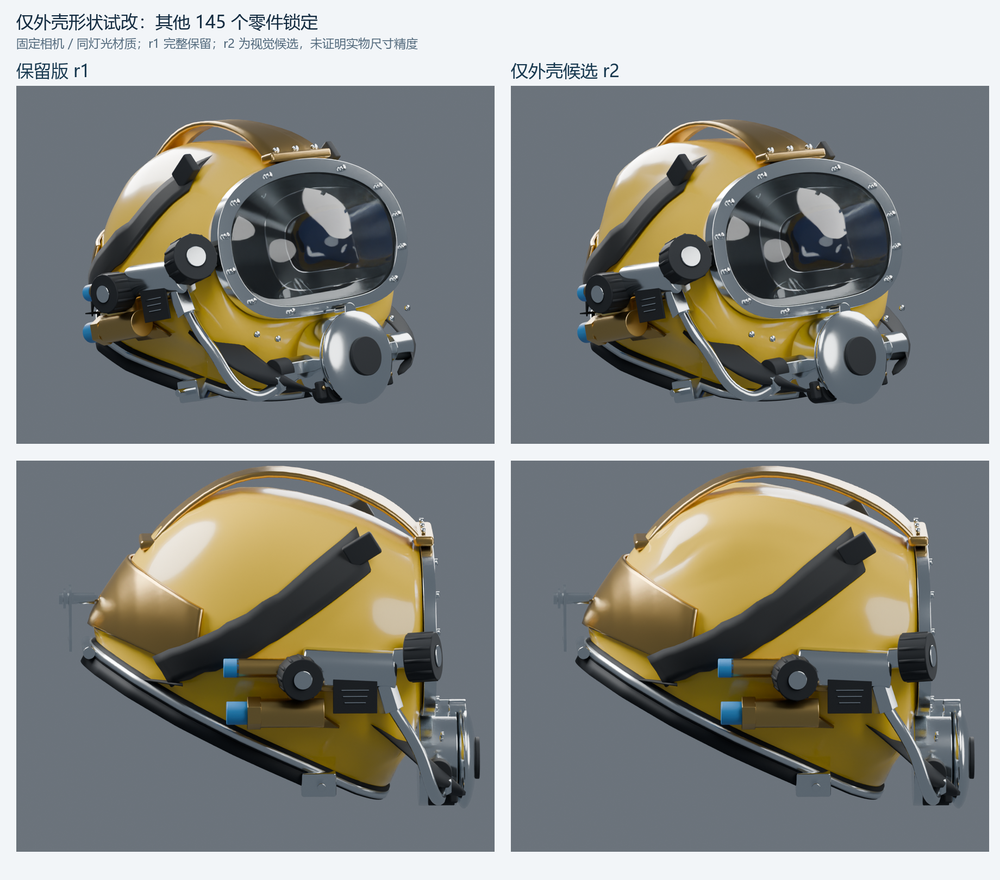

# 仅外壳形状试改 r2

用户于2026-11-12要求保留后部r1，尝试修改黄色外壳，其他零件暂时不动。本件从r1另存，**只有 `Shell_Yellow_520-065_ESTIMATED` 的顶点坐标改变**，其余145个模型对象保持一致。[可编辑r2源](../sources/superlite17b-shell-study-r2.blend) · [保留的r1源](../sources/superlite17b-rear-study-r1.blend)

这是可回退的视觉候选，不是实物测绘或最终定稿。主要变化在冠顶自由曲面及后上方的曲率/体积；附件接触邻域和颈口被锁定，侧后前肩、前下壳等区域变化很有限。高光对照仍可见后上壳体靠近提手后脚处的弯折亮带，不能概括为整体表面已经更平顺。



## 改动范围和保护

- 以r1 SHA256 `f4c3241da1bd541d723d5dcf9cdc9be6a144ca3acdca1911b73002838840ce92`为输入，r1及原v4不变。r2 SHA256 `a595dc7f9979d21c95419fcc80fb2619099afcaf2e9735e8676c47037d1aa894`。
- 外壳仍5880顶点、11760三角面；全盔仍146网格、69056三角面，无增删其他零件。
- 只改变331个外壁顶点及对应内壁点，最大位移约8.873mm（**模型坐标**，不是实物误差修正）。1834个外壁保护点及其对应内壁、4508之后的1372个collar/密封槽点保持原坐标；前窗首圈、196个颈口点及邻接区域包含在保护集合中。
- 附件邻域保护来自实际145个固定对象，不沿用会漏掉新后配重的旧列表。形变是少量平滑控制加位移平顺项，未重新运行历史整盔生成器、未整壳球化或强收颈。
- 壳体拓扑、UV、世界变换、材质及节点连接不变；其他145件的评估后几何、拓扑、UV、变换和材质输入/连接经独立AI只读比较一致。

## 固定照片视角下的实际结果

相机沿用[上轮已保存候选](../camera-baseline-r1/results/camera-fit.json)，改后不再调相机。以下来自实际Blender可见外壳边界，不是单纯优化器的凸包目标；参考描线均为原图片像素，原照片不复制入Git。距离仍受相机、可见区和AI描线影响。

| 可见段，第一遍描线 | r1中位 / RMS，px | r2中位 / RMS，px | 如何理解 |
| --- | --- | --- | --- |
| 前侧冠顶 C05 | 71.92 / 62.22 | 28.24 / 48.31 | 在所选相机下较接近描线；原标注保守量25px，仍有明显残差 |
| 侧后冠顶 | 22.26 / 49.14 | 25.66 / 30.13 | 大偏差减小，但中位距离略变差，不能说每处都改善 |
| 侧后前肩 | 133.96 / 154.33 | 133.96 / 154.33 | 当前保护约束下未改善；不能用冠顶指标代替全壳结论 |

第二遍顺序重描的全部值见[实际渲染边界对照](diagnostics/rendered-boundary-change.json)。两条冠顶弧参与了形状求解，因此不是独立验证集；第二遍也是同AI重读，不代表人类评价。相机仍不唯一、01/04不保证同件实物，指标不能换算成真实毫米精度或整体还原百分比。侧/前肩的大残差没有隐藏，也没有通过挪动其他零件去追图。

[前侧轮廓](diagnostics/front-shell-contours.png) · [侧后轮廓](diagnostics/side-shell-contours.png)：橙色r1、紫红色r2、青色参考描线，提交图不含厂家原图像素。含照片叠图只在本地 `tmp/sl17b-shell-r2/local-previews/`，有原资料者可复跑生成。

## 几何检查与既有限制

[保存文件实际报告](../../../helmet-interaction/qa/runs/20261112-superlite-shell-r2-visual/report.json)确认：145件锁定属性一致，保护顶点零位移；壳体闭合性保持，没有零面积三角面或反向法向；与基准相比，没有新增所检具体非相邻自交/附件表面交叠对。数值保护区域没有通过坐标往返写入，避免细微舍入改变相切判定。

基准本身有22对非相邻BVH表面交叠候选和若干已有附件交叠，本轮仍保留相同具体对，没有证明这些既有问题无害。报告同时比较固定基准三角表和Blender实际渲染三角表；两者本轮相同。不能写成模型完全无穿插。

内外壁配对向量差约3×10⁻⁸m，但这不等于法向壁厚恒定。外壁顶点到内表面的最小**样本**距离约2.617→2.187mm；未出现新增小于0.5mm的样本，完整连续表面的最小厚度并未证明。这些都是模型值，不是制造公差。

原r1挂片下端约8.8mm模型间隔、通信位置未知等限制仍存在，本轮没有改它们。没有Unity导出/导入、真实头显、性能、新构建、水密/承载或人体适配验证。

## 复现与记录

[约束清单](constraints-manifest.json)、[候选参数/逐点位移](candidate-parameters.json)和[实际保存指纹](../sources/superlite17b-shell-study-r2.json)固定来源；选择`moderate`（第二次修改了候选求解策略后的solve-03结果）。`gentle`只是保留的计算选项，没有作为本轮正式源文件交付。

```text
<Blender4.5.14> --background --disable-autoexec --python-exit-code 1 --python <本目录>/prepare_shell_constraints.py -- --output <新约束目录>
<Python3.12+NumPy+SciPy> <本目录>/solve_shell_candidate.py --constraints <约束目录> --output <新参数目录>
<Blender4.5.14> --background --disable-autoexec --python-exit-code 1 --python <本目录>/save_shell_candidate.py -- --parameters <参数JSON> --choice moderate --output <新目录>/superlite17b-shell-study-r2.blend
<Blender4.5.14> --background --disable-autoexec --python-exit-code 1 --python <本目录>/check_shell_candidate.py -- --candidate <保存源> --parameters <参数JSON> --choice moderate --output <新QA目录>
<Blender4.5.14> --background --disable-autoexec --python-exit-code 1 --python <本目录>/render_shell_comparison.py -- --candidate <保存源> --output <新渲染目录> --mode masks
<Blender4.5.14> --background --disable-autoexec --python-exit-code 1 --python <本目录>/render_shell_comparison.py -- --candidate <保存源> --output <新渲染目录> --mode beauty
<Python+SciPy+Pillow> <本目录>/measure_rendered_change.py --renders <渲染目录> --references <原图refs目录> --output <新诊断目录> --local-previews <本地含照片叠图目录>
```

输出均用新目录，不覆盖已引用源或历史证据。下一轮可以依据用户三视反馈选择继续此候选或回退r1；若继续，应优先检查后上壳体保护区附近的高光折转，并在其他零件仍锁定的前提下处理可见自由曲面，不擅自改变前窗、颈圈或后部机构。
