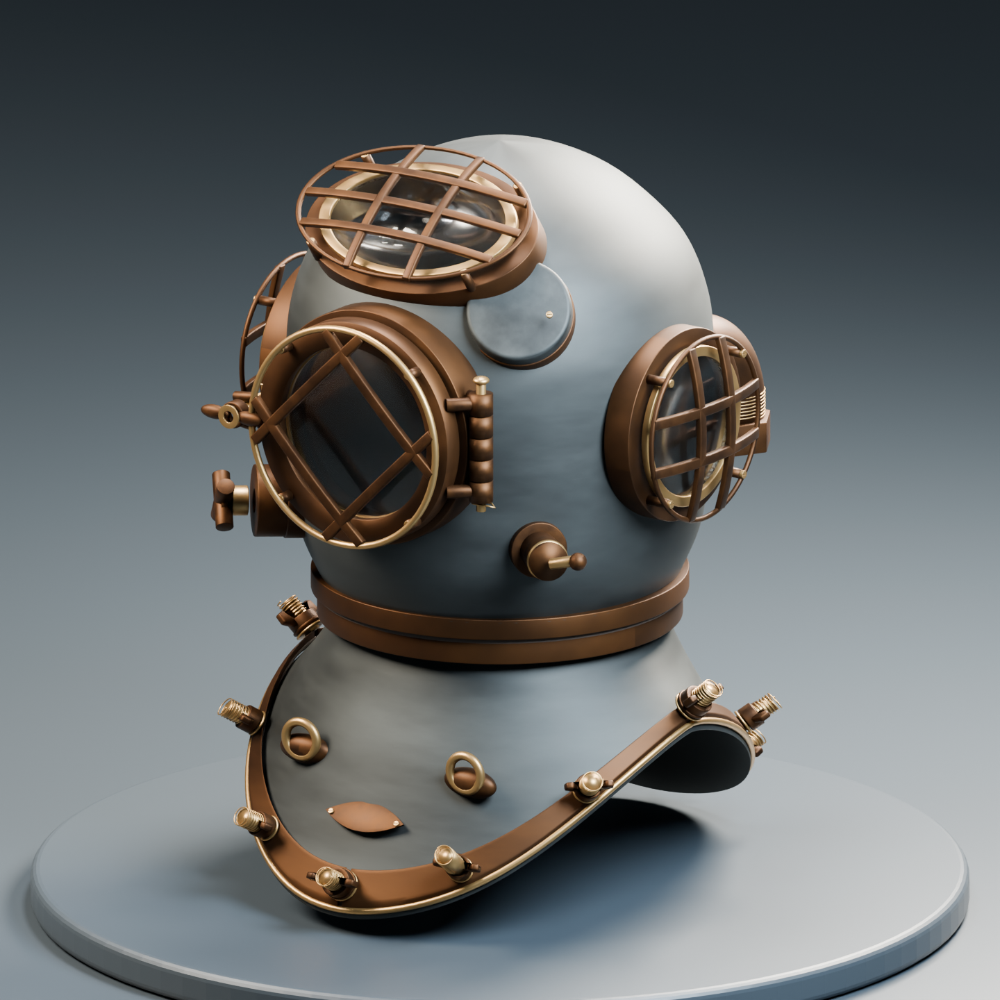
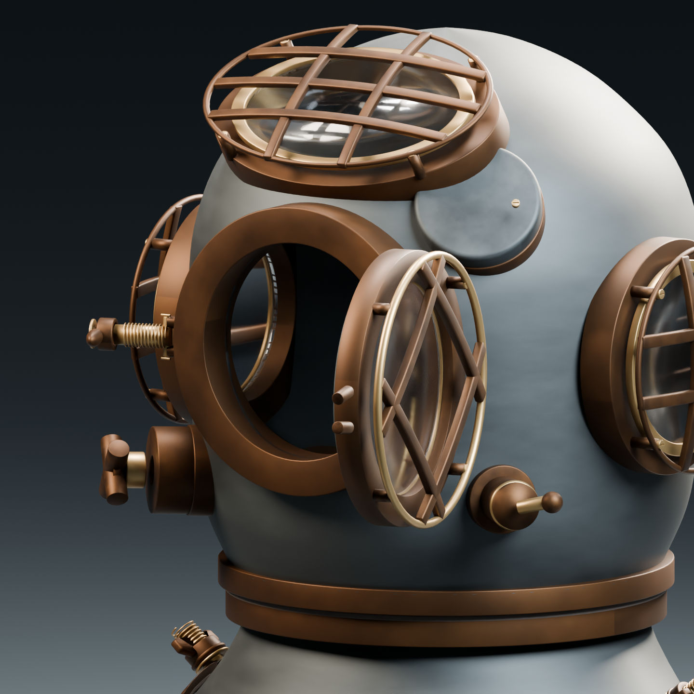

# Mark V Mod.1 精细模型

独立资产候选；不替换 Unity 现用模型。主要外形参照是 Hampton Roads Naval Museum 的1944年 DESCO 标准空气式藏品；不是用户照片里的中国头盔，也不是氦氧混合气版本。

先看 [资料、参数与版本比较](references/research.zh-CN.md)，再对照 `previews/`。已知参数、公开名义规格和建模估算分别保存在 [parameters.json](references/parameters.json)，访问记录见 [sources.json](references/sources.json)。

本轮改动见[R2补充考察](references/refinement-r2.zh-CN.md)：收窄窗框、微调胸板、补密封槽/锁紧转轴/铰链销孔和一根长螺柱，重做较克制的金属外观。原R1证据保存在 `qa/runs/r1-preserved/`。

## 看效果

- 图片：`previews/01-overview.png` 至 `10-interior-interpretive.png`；末张的内部通道是示意，不是该件扫描。
- 旋转查看：同时下载 `preview/review.html` 和 `exports/mark-v-mod1.glb`，用 Chrome/Edge 打开 HTML，点“选择 GLB”。左键旋转、滚轮缩放、右键平移；还可打开前窗或单独看供气、通话、排气和颈锁。
- HTTP 本地预览：在此目录执行 `python -m http.server 8769 --bind 127.0.0.1`，打开 `http://127.0.0.1:8769/preview/review.html`。这个 localhost 仅供自己的电脑，不能作为小组共享链接。
- Blender：用4.5 LTS打开 `sources/mark-v-mod1.blend`，完整源文件已打包6张贴图；隐藏 `90_REVIEW_STUDIO_NOT_EXPORTED` 可只看模型。`01_MARK_V_EDITABLE` 中的部件按功能分组。

## 继续编辑

在 [Issue #25](https://github.com/Twispra/XRmuseum/issues/25) 说明负责哪个部件和文件，再从本工作 PR 的版本开个人分支，注明依赖。不要只从 main 拉取后以为已有这个模型；当前还没有接入 main 或自动汇总到资产分支。

`sources/parts/` 为12个独立 Blender 部件库；在 Blender 用 **File > Append** 选择对应文件的 Object，导入该组件及其子件。也可以把所需 Object 引入自己的场景编辑。**部件库共用 `textures/`，请保留目录关系；不要只发送一个部件 .blend。** 最终总装文件由协调好的单一写入者更新，合并前先核对版本，不能整份覆盖别人的 .blend。

| 目录 | 内容 |
| --- | --- |
| `sources/` | 带审阅灯光/摄像机的完整可编辑总装 |
| `sources/parts/` | 壳体、前窗座、活动前窗、侧窗、顶窗、胸板、空气连接、电话、排气、spitcock、颈锁、内部示意 |
| `exports/` | 整体及独立前窗的 FBX/GLB；均排除摄影棚 |
| `textures/` | 两套原创2048px基色、粗糙度、法线；未复制参照照片 |
| `previews/` | 多角度及打开前窗/内部示意的渲染 |
| `references/` | 可查来源、参数和结构对照 |
| `qa/` | 本次资产回读、几何和浏览器检查证据 |
| `scripts/` | 制作、导出检查及查看器源码；不是 Unity 启动步骤 |

Blender 坐标：Z向上、-Y朝前、+X为佩戴者左侧。FBX/GLB导出为Y向上，+Z朝前。后视左边通话、右边供气。`FrontWindowPivot` 在前视右侧的竖直铰链上；查看器先松开螺母、摆开螺栓，再示意开门100度；关闭/复位反向进行，转角与松动行程为演示估算。下游可以使用 `Anchor_AirOutlet`、`Anchor_TelephoneOutlet`、`Anchor_ExhaustOutlet` 等定位，但目前没有绑定运行时功能。

制作脚本会拒绝覆盖已有总装源文件。复现时使用**全新的空输出目录**；人工修改后不能重跑生成器覆盖文件。`refine_mark_v_r2.py`只对R1已审阅源文件作增量编辑，须另存新目录；不会重新生成总装。R2之后人工修改不能再次运行它来覆盖。依赖 Blender4.5 LTS；查看器打包用 three.js0.180.0 / esbuild0.25.10，MIT声明在 `preview/three-LICENSE.txt`，没有改 Unity Packages。

## 当前边界

这是可编辑、可审阅的精细资产，不是完整历史测绘复原。局部尺度、磨损、内部走线、机械间隙和螺纹牙形仍含估算；铭牌不编造序号/日期。薄片式内部通道、6张原创贴图及几何可以继续优化，浏览器材质效果与 Blender 光线下渲染不同。

未做 Unity导入、运行时模型替换、剖切集成、碰撞体/LOD、真实VR性能或用户测试。源码/导出检查通过不能代替这些检查。先由组员核对参照对象、轮廓和配件，再决定进入资产汇总分支；未来接入 main 另做整合。

当前R2总装255个网格、409,524个三角形、8种材质。三角形数用于评估资产复杂度，不代表VR已达性能目标。检查结果与导出回读差异见 [qa/README.md](qa/README.md)。
