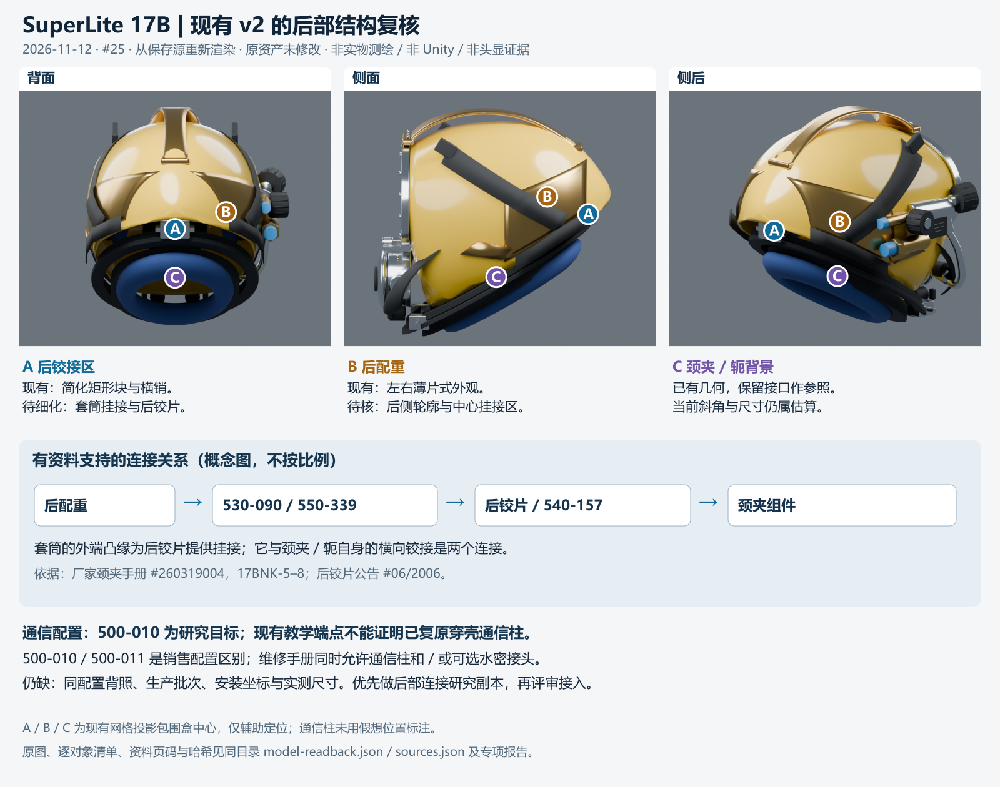

# SuperLite 17B：通信配置与后部附件专项复核（首版）

2026-11-12。关联 [Issue #25](https://github.com/Twispra/XRmuseum/issues/25)，认领者 **Ereshkigal1224（Codex 辅助）**。[认领记录](https://github.com/Twispra/XRmuseum/issues/25#issuecomment-6813952399)。产品基线 `adc06875103cc47a555dd251e3cf80d836a09558`；只读保存的整盔侧轮廓 v2、派生运行 FBX 和 Unity 副本。延续 [11月9日资产审阅](../../../../../docs/activity/2026-11-09-issue-25-era-review.md)，本轮新增厂家版本复核、局部连接解释和实际 Blender/FBX 回读。

## 首版结论

**已有足够依据改善后部连接的解释性结构；精确外形、尺寸及 500-010 通信柱的整盔定位仍待匹配资料。** 先做独立的后配重—定位套筒—后铰片研究样件最有依据。本轮交证据和标注，不修改现有模型或运行时。

目标研究配置继续为 **500-010（posts）**。这只是项目选定的研究目标；黄色展示照与现用 v2 尚不能据此鉴定为同一生产年份、同一序号的 500-010 实物。厂家销售清单区分 500-010 与 500-011，而维修手册允许通信柱和／或可选水密接头；不把销售配置区别解释为两者绝对不能共存。

这是本轮从实际保存源重新渲染的模型图。字母指向模型部件的投影包围盒中心，用于定位讨论；不是实物安装测量。底部关系图是概念连接图，不是等比例工程图。原图：[背面](../../../qa/20261112-superlite-config-review/rear.png)、[侧面](../../../qa/20261112-superlite-config-review/side.png)、[侧后](../../../qa/20261112-superlite-config-review/rear_threequarter.png)。它们不是 Unity 画面、修改后的新模型或头显证据。

## 部件—来源—当前模型—修改条件

| 范围 | 一手证据及定位 | 当前保存 v2 与差异 | 本轮判定／下一步 |
| --- | --- | --- | --- |
| 配置与通信柱 | [厂家产品页](https://www.kirbymorgan.com/products/helmets/superlite-17b) Part Numbers；[通信手册 #250114001](https://www.kirbymorgan.com/sites/default/files/2025-01/communications-on-superLite-17b-and-17c-helmets-kmb-18-and-28-bandmasks-250114001.pdf) 17COM-2、9–11 | 源模型和运行 FBX 未辨认出独立的 515-035 穿壳通信柱；现有教学电话端点是锚点，Setup 的 telephone 渲染器为空。网格名称筛查仅是定位线索，结合图像、生成代码和绑定理解。 | **继续待证**：手册能支持柱、壳体及内侧固定件的局部关系，未给该参考件的整盔安装坐标。暂不补造外露 posts 或把颈夹当通信件；保留主线 Mark V 专属演示策略。 |
| 后配重（B） | [整盔图 #241108001](https://www.kirbymorgan.com/sites/default/files/2025-01/sl-17b-blowapart-241108001.pdf) 第1页 #14：560-005／镀铬版560-006；第2页外观；颈夹手册17BNK-6–7 | `Weights_Brass_Rear_560-005_-1` 和 `_1` 分别表现贴壳薄弧面。背视中线仍是壳体色，厂家图的后配重轮廓和定位套筒连接尚未完整表达。 | **优先研究**连续后侧轮廓及中心挂接区。差异来自实际轮廓、连接与源代码；两个网格的数量本身不作为实物零件数判据。厚度、曲率和孔位仍未知。 |
| 定位套筒与挂接（A） | [颈夹手册 #260319004](https://www.kirbymorgan.com/sites/default/files/2026-03/superlite-17b-neck-clamp-area-including-internal-chin-strap-and-yoke-260319004.pdf) 17BNK-5–7 §1.5；整盔表 #4=530-090、#5=550-339 | 本轮未辨认出带外端凸缘的550-339及其后配重挂接。生成代码以 `Hinge_NeckClamp_Rear` 矩形块和 `Hinge_Pin` 横销简化后部。 | **优先研究**后配重→螺钉／带凸缘套筒→后铰片挂接。单列颈夹与轭自身的横向铰接，避免画成同一根轴。不据此宣布所有横销方向错误。 |
| 后铰片版本 | [厂家公告 #06/2006](https://www.kirbymorgan.com/bulletin/bulletin-06-2006)，2006-12-15生效 | 现有灰色块未对应明确的540-157单片后铰片形状。公告可支持现代研究配置的单片式解释，但不能鉴定原照片生产日期。 | 将540-157作为**现代研究方案**，尺寸继续标估算。公告正文旧号545-013，网页旧件图注写543-013，存在不一致，不静默消除。 |
| 颈封／轭（C） | 颈夹手册17BNK-6部件图、17BNK-8中心线对中示意；整盔图 #66=505-008 | `Neck_Yoke_520-117`、`NeckClamp_505-055`、`NeckDam_Neoprene_510-533` 已保存。三视与源代码仅说明现有模型的简化形状；没有新测量可证明约30.1°斜面或开口尺寸。 | 保留现状作为后部研究样件的接口背景，后续对照开口、锁紧及对中关系。暂不改整盔尺度或把模型参数改写为厂家尺寸。 |

17COM-2/9/10/11、17BNK-5/6/7/8和整盔图第2页均已临时下载并用Poppler渲染后由Codex视觉核对。厂家原件及页面图只留本地忽略目录，仓库仅交链接、文档号、哈希与本项目模型图。[查阅清单](../../../qa/20261112-superlite-config-review/sources.json)

## 推荐下一轮的两个小范围

1. **后配重外观及中心挂接区**：用现有轮廓作对照，独立制作可编辑研究副本，表现连续后侧结构；只依据已核图示调整拓扑和可辨外观，所有未测尺寸明确标估算。
2. **550-339／540-157局部关系**：制作独立拆分示意，区分套筒挂接和颈夹／轭横向铰接。显示部件身份、连接顺序及依据，不宣称精密装配或真实承载。

两项可合为一个小型后部附件研究样件。已有源与历史报告保留；研究方案先评审，再按 #25 的独立资产流程交付。产品接入若被明确纳入后续任务，再从最新main协调FBX、Unity副本、剖面缓存、现有GUID及交互回归。本轮不占用这些共享产品文件。

## 已验证及仍未解决

- Blender **4.5.14 LTS** 真实重开保存 v2：143 网格、50,268 三角面；另在空场景导入实际派生 FBX：143 网格。新渲染为背、侧、侧后三视。
- v2源 SHA256 `54a21895b807a19ccc0345a25101cb5369c0a9c976d175a40a58a528a5b8b905`；导出与Unity副本均为 `febfddaf522c50b0044237998c7a661b1bbb1d1220fb07588cfc3e23f5718fda`。三文件在读取前后不变。[实际回读](../../../qa/20261112-superlite-config-review/model-readback.json)
- 查阅产品、零件、维修与公告资料后，仍未找到同时可确认500-010配置、生产批次、清晰完整背视及尺寸的一手材料；局部维修照片不替代同件整盔测绘。
- 当前用户头显不可用。本轮没有Unity运行、真实控制器、双眼、可读性、触达、性能、构建或用户研究结果；旧模拟报告只作为历史证据。
