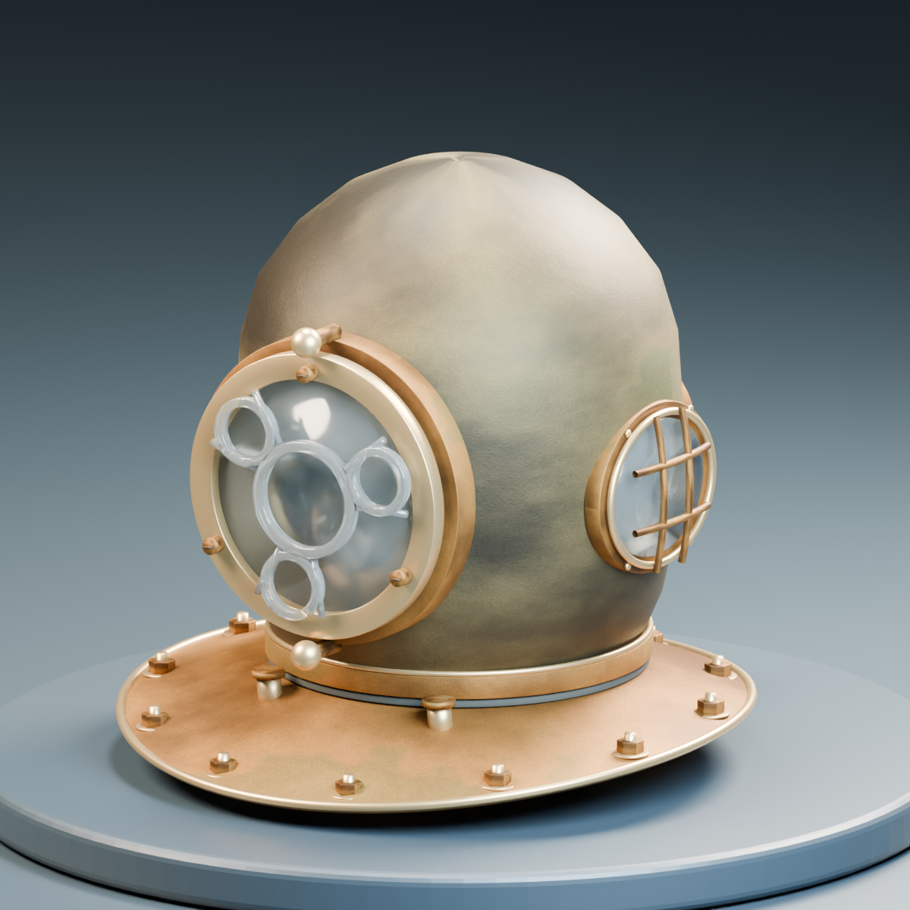

# 照片头盔：第一版外观研究

任务 [#26](https://github.com/Twispra/XRmuseum/issues/26)，总任务 [#25](https://github.com/Twispra/XRmuseum/issues/25)。负责人 Fttt1003。型号、尺寸待核实，现有 Mark V 保留。

先读 [研究与交接说明](../../../docs/models/photo-helmet-study.md)。

- `sources/`：可编辑 Blender 4.5 LTS 源文件，一个文件同一时段一位编辑者。
- `exports/`：整体和前窗的 FBX/GLB，均由本目录源文件导出。没有 Unity 使用副本。
- `previews/`：五个视角，适合 Issue/PR 标注反馈。
- `preview/review.html`：双击后选择本地 GLB，旋转、缩放、查看分件；无需在线 CDN。
- `textures/`：原创基色、粗糙度、法线，共六张；不是照片扫描。
- `qa/`：照片来源哈希、几何统计、导出回读结果及查看器检查结果。
- `scripts/`：建模、回读检查和查看器源码。重新建模使用新输出目录，不覆盖人工修改。

没有安装 Blender 时，查看器或 PNG 即可反馈。使用 Git 的组员先 `git lfs pull`；需要精修时从本任务认领部件，不直接覆盖现用模型。未知内部、性能和铭牌字样不按想象补全。
