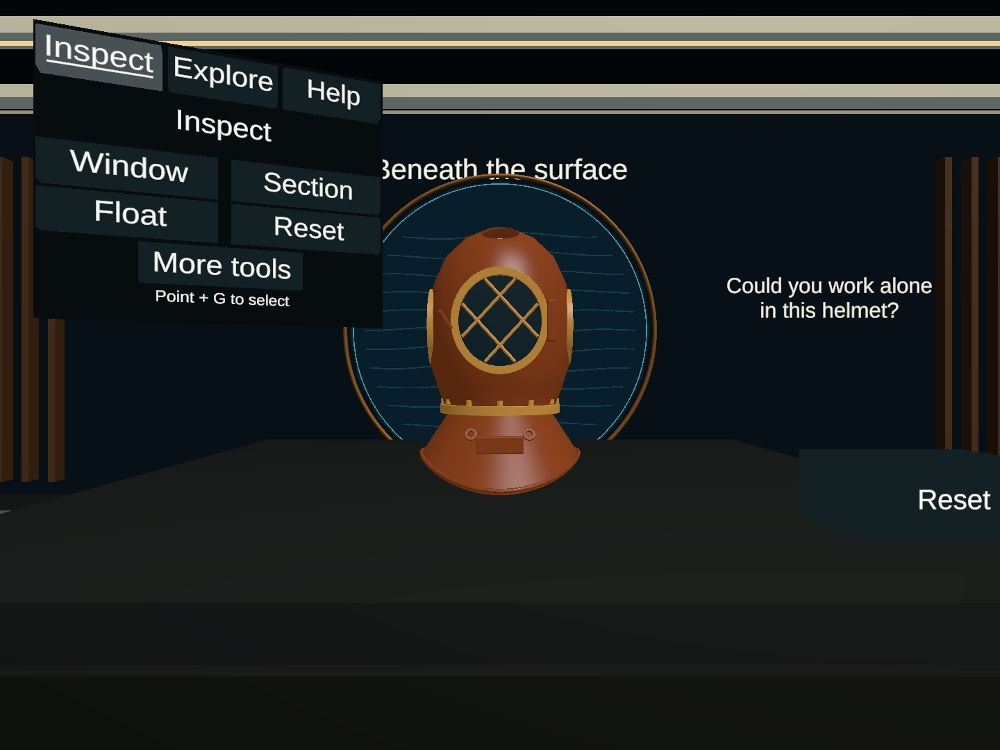
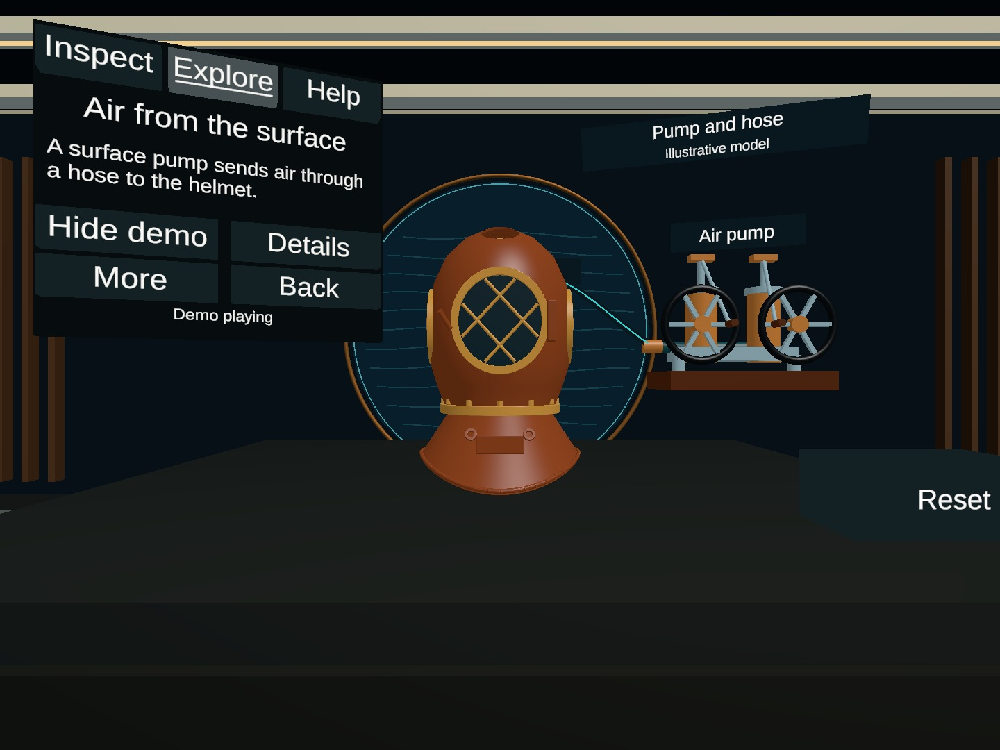

# 展陈信息安排：实现与发布交接

用户希望减少满屏文字，同时保留已有的观察、剖面和供气／通话探索；已授权直接在 Unity 实现。

## 工作范围

- Issue：[#8](https://github.com/Twispra/XRmuseum/issues/8)。分支：`codex/exhibit-information-2026-10-03`。
- 开工同步主线 `b40eb9f652a3935595575e6a5ec0f287c09777b5`，环境 PR #5 与探索 PR #7 已合并。
- 直接修改原 `MuseumStart`，没有重建灰模、XR Rig 或另做展示场景。场景由本任务统一写入，子任务分别负责面板、验收和资料。
- 用户随后授权发布；源码提交 `2504ccd` 已推送，[PR #9](https://github.com/Twispra/XRmuseum/pull/9) 指向 main，等待组员审查，未自动合并。既有未跟踪的旧截图、文档和 `.vscode` 保留在本地。

## 做了什么

把原来同时显示的说明和操作拆为三层：环境给主题，个人面板给当前操作，Help / Details 给主动查阅的内容。

| 位置 | 当前安排 |
| --- | --- |
| 环境与展台 | 一处引导问题，简短展品身份；重复口号和操作长文收起。设备演示显示时，背景主标题暂时收起，隐藏设备后恢复。 |
| Inspect | Window / Section / Float / Reset 为基本操作；More tools 展开旋转、倾斜和剖面细调。 |
| Explore | 先选 Air 或 Voice；进入线索后只显示相关操作。More 展开 Hint / Review，New visit 留在 Review。 |
| 演示 | 短设备名、短阶段说明和 Illustrative model；结束后写 Static model view，不写成暂停。可 Replay。 |
| Help / Details | 主动打开，Return 返回原上下文，不自动播放或定时关闭。模型可见时始终保留 Hide demo，Inspect 中也能收起。 |

现有 G 握持／选择、Home 复位、射线与直接接触均沿用。当前 Help 解释键盘模拟器的操作，不是头显操作教程。

## 使用与维护

1. Unity 2022.3.62f3c1 打开 `MuseumVR`，加载 `Assets/Museum/Scenes/MuseumStart.unity` 后 Play。
2. 先点击 Game 取得键盘焦点，用原模拟器 T / Y 选择手柄，射线指向按钮后按 G。
3. 在 Inspect 展开 More tools；在 Explore 选择 Air / Voice，再试 Details、Help、Return 和 Hide demo。
4. `HelmetInformationLayoutSetup` 是一次性场景迁移工具，**保存场景已经完成迁移，日常打开不用运行**。它会拒绝重复迁移。原型 Build 和旧安装器也不应重跑。
5. 后续改面板优先修改 Panel 的状态布局，不直接扩大所有文字框或把隐藏按钮强制开启。两种模型动画及访问记录仍由原 Controller 管理。

代码集中在 HelmetExploration 的 Panel / Button / Controller，设备演示仅改说明布局；HelmetInspectionPalette 增加按内容确定面板范围和优先位置，保留原跟随、悬停冻结和避障。

旧布局已序列化留存；停用探索功能恢复原观察工具。资料来源、具体设计依据和边界见[信息安排说明](../exhibit-information.zh-CN.md)。没有导入网页图片、第三方 UI 或新字体。

## 验证

每次运行使用独立目录，早期截图和报告保留，不把早期通过记录写成最终版本结果。

- 最终探索与布局：[1469 项检查报告](../../artifacts/helmet-exploration/qa/runs/20261003T131904705Z-exploration-35eccc55fdc64475904c80e6ec13ead4/report.json)，全部通过，运行时错误 0，批处理退出码 0。包含可见按钮的模拟选择、隐藏对象不可选、文字溢出与阅读区重叠、四态主视角边界、Help / Details、演示生命周期和资源复用。
- 原观察与剖面：[206 项报告](../../artifacts/helmet-interaction/qa/runs/20261003T132216493Z-inspection-main-765c3e4956c049b6822da05a6a92192f/report.json)，全部通过，错误 0，退出码 0。原来的距离、悬停冻结、窗口、剖切与复位要求保留；测试寻找折叠后的工具时会先实际选择 More tools。
- 原拿放与复位：[90 项报告](../../artifacts/helmet-interaction/qa/runs/20261003T132401996Z-6acb5ce49e764e97ab793db79231d025/playmode-validation.json)，完成 10 次拿放循环，全部通过，错误 0，退出码 0。
- [最终文件与进程核对](../../artifacts/exhibit-information/qa/20261003T132516Z/audit.json)：三份报告记录的源码哈希均与交付文件相符。开工时记录的 640 个文件中 632 个完全不变，8 个改动均在计划范围；原场景 467 个序列化对象 ID 全部保留，80 个原相机、MeshFilter、物理组件逐块未变。新增内容是面板按钮、材质与迁移工具，没有替换模型或 XR 输入。

Unity 2022.3.62f3c1 的原始被测状态为 `b40eb9f` 加当时的未提交修改。[发布核对](../../artifacts/exhibit-information/qa/20261003-publish-audit/audit.json)确认测试文件与源码提交 `2504ccd` 对应；发布时没有重复运行 Unity，也没有改动已验证的产品文件。报告数量是自动断言数，不代表参与测试的人数或独立用户任务数。

下面是原场景的 Unity 渲染，不是设计示意图。两张均使用相同的生产相机位置和视野；报告中的 `panel-closeup` / `diagram-closeup` 文件则是明确标注的临时检查机位。

视觉走查发现并修正了两类自动点击无法代替的问题：面板虽然可操作，但可能位于屏幕边缘；页面变高后可能与展台相撞并触发避让。另一次原功能回归发现面板距离超过原来的 1.1 m 检查条件，随后收回优先位置，保留原测试条件，没有为通过而放宽限制。最终验收包含主视角按钮边界、正文与按钮重叠、帮助返回和原有功能回归。

本轮只针对编辑器与键盘／XR 模拟输入。没有进行真实头显、老年用户或其他目标用户测试，也没有宣称无障碍标准、舒适性或可执行构建已验证。

## 后续交接

先由组员实际体验新分组是否容易找到功能，再决定是否继续精简。真实设备的字号、视角、距离和长时间阅读仍需另验。本次按仓库模板发布到 PR #9，只纳入任务文件、三份原始报告、四张代表性画面及审计记录。原始报告列出的其他诊断近景和失败截图仍保存在本地，没有全量上传。由另一位组员审查后再决定合并，后续共享场景写入仍需由整合人协调。
