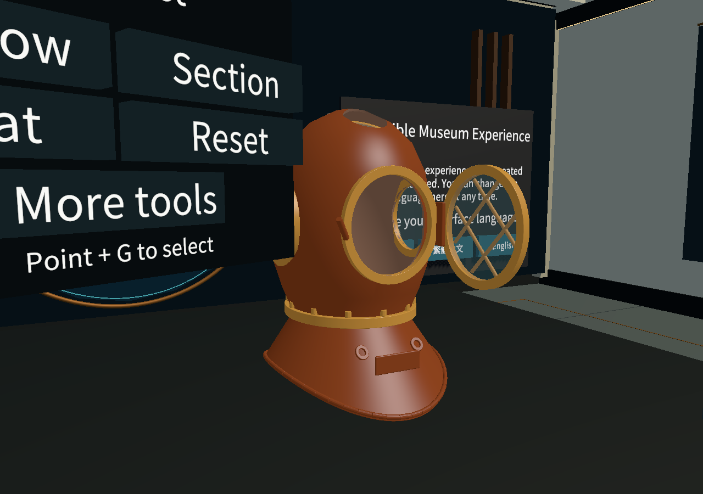
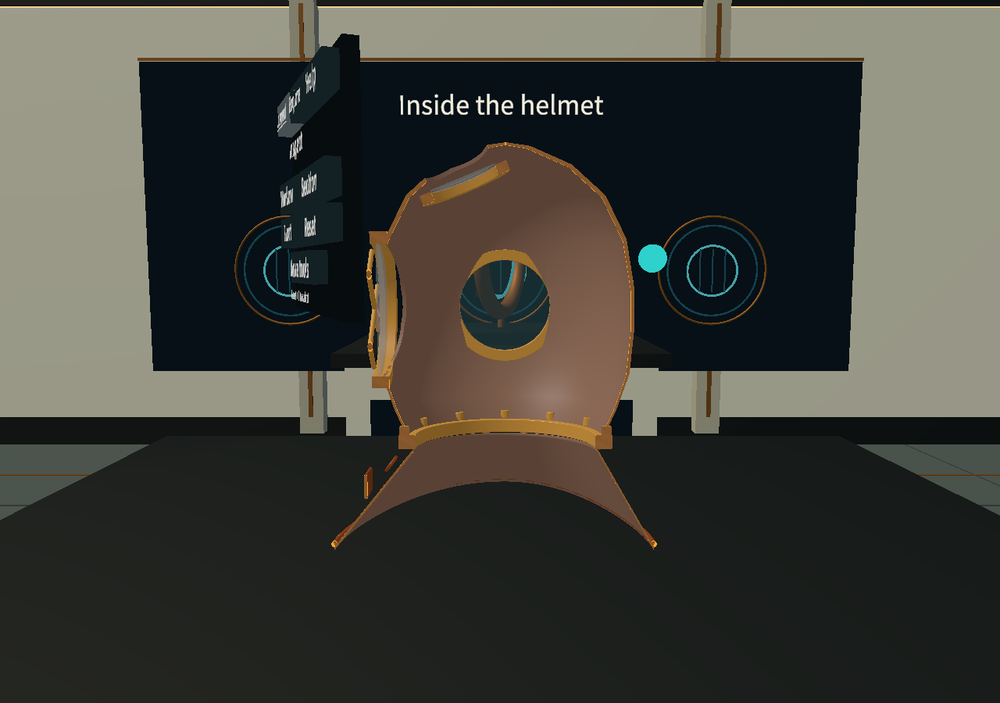

# 2026-10-06：头盔体验细节完善

用户要求实现前窗玻璃／开合／声音、结构清楚的切口、供气／通话的目光引导，以及连贯复位。由发起任务的成员负责，Codex 辅助代码、保存资产迁移、程序音效、测试和交接；未编造其他成员贡献。

开工基准 `d432a37d1107f4b4f1ca2aa64c7819f229549dab`，功能分支 `codex/helmet-experience-polish-2026-10-06`。fetch 后 main 为 `b4e1886`，GitHub 只有本人的三语 PR #18 开放，无其他开放 Issue。新功能明确依赖 #18；本轮没有提交、推送或创建新 PR。保存前核对 tracked 改动为空，并给 1795 个已有 Git／未跟踪文件建立本地 SHA256 快照。

修改集中在新的 HelmetExperience 模块、原前窗／复位及探索动画的相应方法，原 InspectableHelmet prefab、Window 材质、MuseumStart 中声音按钮和原 Reset 按钮接线。添加两条三语文案；字体源增加所需的「聲」，源子集 7652 码位，静态图集 510 字符，原 GUID 和子资源引用保持，保存像素哈希核对通过。195 条文案、500 个当前显示字符；静态图集继续保留此前已有的额外字符。没有改 Packages、ProjectSettings、输入或模型源／导出／Unity FBX。

## 检查与修复记录

- 新脚本首次编译发现波形循环中的局部变量放置错误，修复后编译通过。
- 场景升级日志发现 MonoBehaviour 字段初始化调用 MaterialPropertyBlock 的错误，改成首次使用时创建。后续验收记录无此异常。
- 首次动作验收发现前窗缓动接近终点时角度差很小，可能漏掉末端音效。末端判定移出速度阈值后复测通过。
- 一次新演示检查在测试脚本复位后同帧直接启动演示，被原探索控制器的复位同步正确停止。调整测试夹具等待原状态同步；没有删除原停止逻辑。
- 字体烘焙成功并校验保存像素／引用，但工具的 RunBatch 本身不退出，启动时遗漏 `-quit`，该自建后台进程被结束，实际退出 -1；不把它记为进程成功。字体资产由后续独立主场景／语言验收再核对。
- 复位检查发现 XRI 的待应用目标与暂时锁定的刚体有配合问题，复位后明确消费一次目标，再呈现短返回；原公共 API 和释放后再抓保护保留。

各次失败报告保留在独立本地运行目录，不覆盖，也不作为成功证据。最终冻结代码的四组检查均通过，实际 Unity 进程退出码均为 0：

| 检查 | 结果 | 范围 |
| --- | --- | --- |
| 新体验功能 | 60 项通过 | 玻璃、缓动及末端声音、保留空腔的切口、切面缓存、连续返回、静音、发送／到达强调 |
| 三语言整合 | 79001 次断言通过 | 包含重复文字与字形检查，不代表 79001 个独立测试；覆盖新增声音开关与原生产语言按钮 |
| 原探索回归 | 1486 项通过 | 原供气／通话输入、停止／重播、回顾及布局 |
| 原头盔操作回归 | 206 项通过 | 原主场景拿放、前窗、剖切、复位及模拟 XR 输入 |

完整运行目录、报告哈希、被测产品文件哈希和截图索引在 [交付摘要](../../artifacts/helmet-experience/delivery-20261006/summary.json)。最终新增功能运行是 `20261006T073141850Z`，三语言 `20261006T073239758Z`，探索 `20261006T073405521Z`，原操作 `20261006T073653116Z`。未记录运行时异常或失败断言；缺少真实 OpenXR 运行环境的初始化提示不作为头显测试成功。

交付核对确认 1795 个开工快照文件中的 702 个原未跟踪文件未改；更早保留的 570 个未提交文件也逐个哈希一致。原 `.meta`、模型、Packages、ProjectSettings 和输入配置没有差异。`git diff --check` 与 `git lfs fsck` 通过。测试完成后的产品文件与测试记录哈希相符，文档补写不改变被测产品。

以下图片来自保存的 MuseumStart，通过临时诊断相机和明确设置的组件状态取景，方便审查局部效果；不是额外的产品场景，也不是头显截图。

## 接手与限制

使用方法、组件分工、资产来源和安全重建边界见 [功能说明](../helmet-experience-polish.zh-CN.md)。合并仍需另一位成员看实际 diff 和证据，不能将 AI 检查当人工批准。

玻璃色调、反射、截面颜色、网格表现、声音和返回轨迹属于教学原型选择。截面只从已有网格生成，未还原新历史结构，也未加入碰撞体；原完整碰撞包络保留，不能把剖面理解为可伸手拆内部零件。图形不能证明真实机械、气流或信号速度。程序音效不依赖外部音频许可，合成算法记录在代码中。

真实头显、用户、双眼透明排序、人工声音舒适性、构建及性能未验证。截面重建涉及约 6.2 万源三角形，仅在切面／活动窗变化时计算，最终设备性能需测量。声音可关闭，减少动画设置也继续支持。
