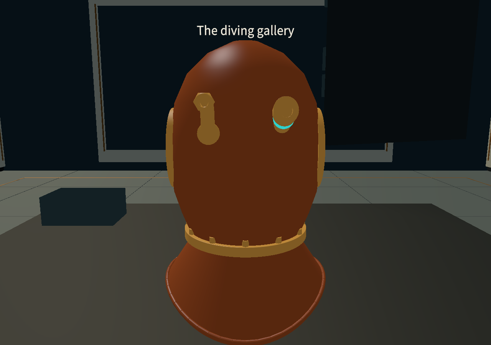
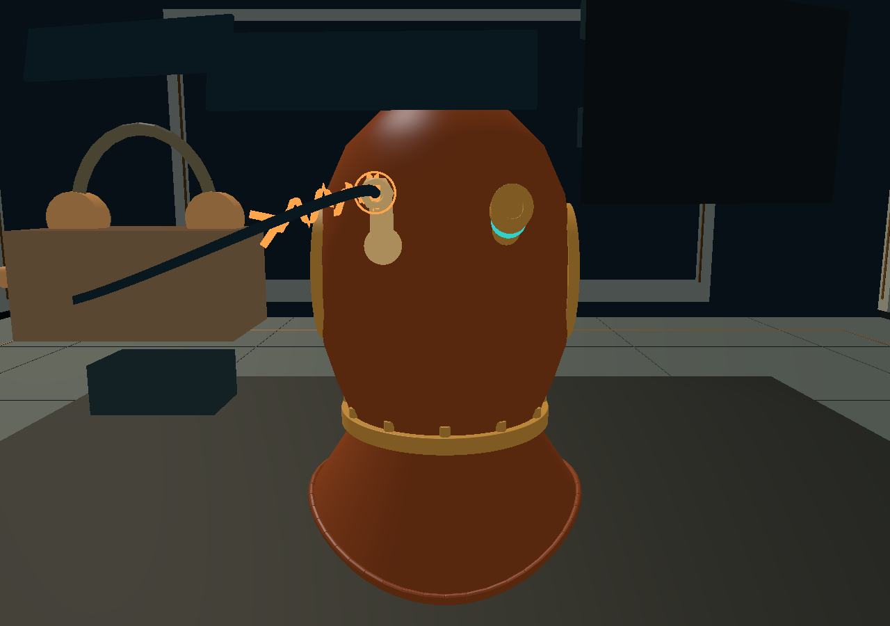

# 2026-10-06：补齐背部电话接头

用户要求补齐电话鹅颈接头，让通话电缆、到达动画和高亮对应它，供气保留另一侧独立接头。本轮继续在本地 `codex/helmet-experience-polish-2026-10-06` 上完善同一体验，HEAD `d432a37`；依赖前一轮未提交的体验细节和未合并的三语 PR #18。没有提交、推送或创建新 PR。开工时保存了 2017 个已有 Git／未跟踪文件的 SHA256 快照，保留原有工作。

## 做了什么

- 保存的 InspectableHelmet 中增加独立电话鹅颈：弯管、底座、连接螺母、空心出线口。几何由 `HelmetRearConnectionsSetup` 生成并保存为独立 Mesh asset，没有替换／重新导出原 FBX。
- 校正后方左右位置：从后面看左电话、右供气。原灰模供气接头原在另一侧，移动其两个子对象的位置，保留对象身份和原网格；同步刷新原 AIR 热点缓存。
- 供气路线到现有供气接头的出口；通话路线到新电话出口。出口是头盔局部锚点，随整盔位姿变化，不固定在世界坐标。
- 消息到达时，电话接头获得材质强调及小范围响应环；回复从头盔端开始，水面收到后释放头盔端强调。停止、切换供气和禁用演示时清理反馈，减少动画保留静态响应。
- 配有实际接头的主场景不再把漂浮的“潜水员端”示意装置作为电缆终点。原装置代码与资源复用保留，缺少新接头配置的旧场景仍能使用原示意，不制造空引用。
- 新电话金属网格加入原可剖切渲染器和截面数据；响应环不混入结构截面，切面移除该侧时隐藏响应环。
- 新接头和原供气两件使用已有黄铜材质，与铜壳区分；电话根部伸出壳体，底座沿后部表面方向衔接，避免未高亮时看不清。
- 新增 `experience.telephone.connection` 三语文案（通话接头／通話接頭／Telephone connection）。共 196 条；没有新增显示字形，也没有改字体文件。

## 依据与边界

[美国海军水下博物馆：MK V Diving Rig](https://navalunderseamuseum.org/mk-v/)明确说明后部两只鹅颈：从后面看，左接电话，右接供气软管。对应标准空气式 Mark V；不要把混合气版的其他连接或排气阀混入这两个接口。

接头弯曲半径、壁厚、螺母大小、材料显示和响应环属于原型建模参数，不是实物测绘数据。没有增加历史内部电话设备或真实电气／流体仿真。响应环是展示提示，不是实物零件。原 FBX 仍是 9 月 23 日灰模，保存 Prefab 上的追加资产构成当前展示模型；回退时应按组件与引用迁移，不整份覆盖原模型。

原 FBX 与导入设置、输入、Packages、平台和既有 metadata 不改；保存 Prefab 增加接头并调整原供气子对象。新增 Mesh／脚本拥有自己的 Unity meta。新增几何不增加碰撞体或抓取目标，沿用原完整头盔交互范围。Codex 辅助代码、程序几何、资产迁移和模拟检查，无外部下载模型／音频／图片。

## 验证与接手

新版 `HelmetExperienceValidation.RunBatch` 检查背部左右、两个真实出口、动画收发、材质属性、移动旋转跟随、停止清理、减少动画、剖面响应与复位。截图是在保存的主场景用临时诊断相机取景，不是独立产品场景，也不是头显测试。原输入、语言与探索回归分别使用既有验证入口。

首次新版功能 77 项、三语与原探索检查通过；原头盔回归发现剖切工具中心偏移约 2 毫米。原因是追加接头扩大了用于确定工具中心的包围盒。修正为新电话网格参与渲染和切口，但不改变原工具的定位包围盒；没有放宽原测试误差要求。最终重测已覆盖原正负临界角、极点附近的连续手腕旋转和重抓，206 项通过。失败运行保留在原独立目录，不作为成功证据。

最终冻结产品的检查结果如下，四组实际 Unity 进程退出码均为 0，报告中异常与失败断言均为 0：

| 检查 | 结果 | 运行 |
| --- | --- | --- |
| 接头与原体验细节 | 76 项通过 | `20261006T090243870Z` |
| 原头盔操作 | 206 项通过 | `20261006T090053550Z` |
| 原探索流程 | 1486 项通过 | `20261006T090506143Z` |
| 三语整合 | 78760 次断言通过 | `20261006T090341382Z`；包含反复检查文字与字形，不代表相同数量的独立测试 |

原型第一次的 77 项与最终 76 项数量不同，是逐个当前有效截面网格检查的数量随几何／工具范围变化；接头的必需场景全部保留，没有删除原断言。完整报告、对应最终进程、被测文件 SHA256 与保留审计见 [交付摘要](../../artifacts/helmet-experience/rear-delivery-20261006/summary.json)。核对确认开工快照内只有约定范围的 11 个已有文件修改（包含状态交接更新），更早的 570 个未提交文件逐一哈希一致；原字体文件也未变。`git diff --check` 和 `git lfs fsck` 通过。

在原主场景查看：观察 → 更多工具 → 向右转六次（每次 30°），再切到探索 → 通话或供气。原 T／Y 手柄选择与短按 G 操作保留，也可直接握住头盔转动。复位会恢复展台姿态。

日常直接打开 MuseumStart。新增组件是 `HelmetRearConnections`，负责已保存出口及电话反馈；`HelmetConnectionDemonstration` 通过保存引用消费它。迁移入口只在明确更新资产时使用，不能作为日常打开／测试步骤。以后修改接头或模型，需同时核对锚点、剖切渲染器、SectionMeshData 与 AIR 热点；不要只改外观而留下旧路线。

真实头显、声音舒适性、可执行构建、设备性能和目标访客评价未验证。
