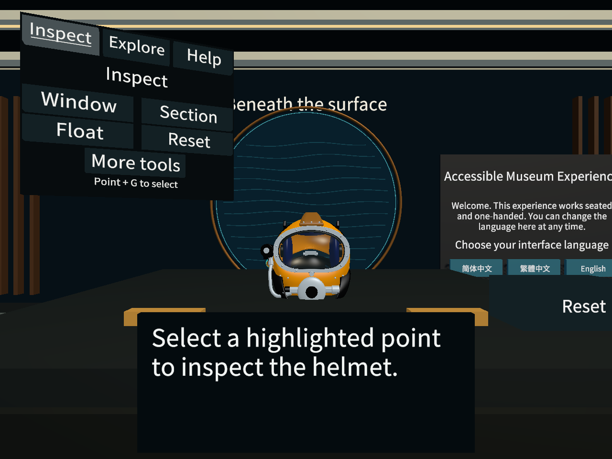

# 2026-10-11：SuperLite 17B 最终总装与 Unity 展示台接入

## 授权、认领与实际基准

用户接受整盔 v2 后要求上传 Git；独立资产 PR #43 已合入 main。本轮又明确要求认领“主体与最终总装”、同步最新 main，并用精细头盔替换三年代展台中的一个粗模。

GitHub 当前账号为 Ereshkigal1224。Issue #25 的原表格仍写研究扩展待确认，但 10 月 9 日后续记录已经接受整盔研究；资料和细节两项已有该账号认领。第三项本轮新增[认领评论](https://github.com/Twispra/XRmuseum/issues/25#issuecomment-6108058970)，通知 @Fttt1003，记录本分支、基准和共享文件范围。评论表达此次认领，不虚构其他成员已回复批准。未认领另两个年代的制作，也未关闭整个 Issue。

开工分支 `codex/superlite17b-whole-helmet-2026-10-11`、HEAD `3f80950e447f75cd56b498e3bb0319b2422423b2`；已有未知 `?? XRmuseum/` 保留。读取项目状态、协作指南、Issue 当前评论、资产 PR 与开放 PR 后 fetch origin，实际 main 为 **`06e68e89871fdac278f64c2ec58a1df866291360`**，包含 #43 以及 #38/#41/#42。将本地 main 快进到该提交，随后创建 **`codex/superlite17b-unity-integration-2026-10-11`**。没有未合并产品依赖，未重置、清理、暂存或上传未知目录。

## 完成的变化

从已接受的保存源派生两份相同 FBX，保留源哈希 `54a21895b807a19ccc0345a25101cb5369c0a9c976d175a40a58a528a5b8b905`。导出及 Unity 副本 SHA256 均为 `febfddaf522c50b0044237998c7a661b1bbb1d1220fb07588cfc3e23f5718fda`；143 网格、50,268 三角面不减面，剔除建模舞台。真实尺度尚未测绘，宽/高/深 0.282 / 0.314 / 0.325 米仅为保存源的展示估计。

扩展既有 `RefinedHelmetBinding`，让索引 2 使用 SuperLite；索引 1 继续 Mark V，索引 0 保留早期占位。切换更新可见网格、面窗命中范围、剖面缓存、AIR/VOICE 锚点与强调；保持原 XR、物理、归位和语言入口。新总装保存到同一个 `InspectableHelmet.prefab`，GUID `7eef595f081bc0a4fabb2153e06a553d` 及 482 个原对象 ID 保留；原 Rigidbody 和碰撞组件不变。主场景未重存，Packages/ProjectSettings 未改。新增 FBX GUID 为 `a2433ca4215aebd48ab4e446902402bf`，新资产自身 meta 完整且无新 GUID 重复。

前窗 14 个分件随既有交互轴移动；另建 142 个不透明网格的剖面缓存。新材质沿用本组剖面/透明玻璃着色器，转移基本材质参数，没有烘焙 Blender 程序凹凸或涂层。旧研究分件、Mark V 与原始整盔全部保留。

两次初始验收发现放置悬空；结合原动态根节点运行时落稳高度校准，而非改动展台或原物理配置。原 home 为约 1.172 米，运行时根节点约 1.160 米，展示顶面 1.100 米，新模型底部 1.103 米。失败诊断摘要见[校准诊断](../../artifacts/superlite17b-unity-integration/qa/placement-diagnosis.json)，完整本轮试运行留在忽略的 `tmp/sl17b-placement-trials/`，不覆盖任何已引用历史报告。

## 验证与交接

被测版本为基准 `06e68e8` 加本轮未提交产品文件：Prefab、绑定代码、验收代码、新 SuperLiteModels 资产；报告记录当时完整 dirty 与文件 SHA256，另有开工已存在的未知 `XRmuseum/`。最终提交只纳入本轮认领路径、配套记录及有用证据；不把基准 commit 冒充干净产品测试版本。

环境为 Windows、Unity **2022.3.62f3c1**、Blender **4.5.14 LTS**。首次安装/校准完成后，用保存场景运行：

```text
Unity.exe -batchmode -projectPath <repo>/MuseumVR -executeMethod Museum.RefinedModels.EditorTools.RefinedModelValidation.RunBatch -logFile <repo>/tmp/sl17b-unity-qa-final.log
```

不使用 `-quit` 或 `-nographics`；验收负责结束编辑器并保存临时渲染。退出 0，**172 项全部通过、无报告 errors、20 张截图**。[最终报告](../../artifacts/helmet-interaction/qa/runs/20261011T110449197Z-refined-integration-6556d86dba254348b8b4f309db76b605/report.json)验证原 Mark V 和新 SuperLite 的实际 InputSystem → XRI 抓取/按钮，年代切换可见性、轴向/单位、前窗开闭、剖面、模型落台、连接端点和语言保留。年代、语言状态及连接演示部分使用明确标注的公开 API，不冒充全部物理按钮实测。



[阀侧近景](../../artifacts/helmet-interaction/qa/runs/20261011T110449197Z-refined-integration-6556d86dba254348b8b4f309db76b605/16-superlite-reference-side.png)、[虚拟面板展开](../../artifacts/helmet-interaction/qa/runs/20261011T110449197Z-refined-integration-6556d86dba254348b8b4f309db76b605/18-superlite-virtual-panel-open.png)、[剖面](../../artifacts/helmet-interaction/qa/runs/20261011T110449197Z-refined-integration-6556d86dba254348b8b4f309db76b605/19-superlite-section.png)、[抓取](../../artifacts/helmet-interaction/qa/runs/20261011T110449197Z-refined-integration-6556d86dba254348b8b4f309db76b605/20-superlite-held.png)。截图是实际保存场景的桌面渲染；教学端点的青色高亮不是实物材料。

Blender 导出/实际回读及 Unity 总装报告通过；[资产一致性检查](../../artifacts/superlite17b-unity-integration/qa/asset-parity.json)十项通过，包括 LFS 实体、两份 FBX、原对象/物理组件、GUID、主场景与保存源。提交前执行 diff 空白检查和逐文件暂存，LFS 指针/对象另核对。

因修改了共享 Prefab 和精细绑定，另运行 `Museum.Localization.EditorTools.LocalizationIntegrationValidation.RunBatch`，退出 0；默认 Mark V 的保存场景、语言按钮、三语文字/字形、生命周期和 Direct / Ray 热点回归通过。[派生摘要与文件指纹](../../artifacts/localization/qa/runs/20261011T110907098Z-integration-22e76b072ca64643a2020ecf9dbbdcb2/summary.json)、[768 项热点检查](../../artifacts/localization/qa/runs/20261011T110907098Z-integration-22e76b072ca64643a2020ecf9dbbdcb2/hotspot-interaction.json)及六张热点诊断截图保留。总断言 84,154 条大量为重复字形/状态检查，不解释为同等数量独立行为。原约 19 MB 完整报告保留在忽略的 `tmp/sl17b-localization-full/`，SHA256 `8c380a3d8bf46b68baccf0ee74be6aaef3f801b919842284469b29ce4b09a3c8`；摘要明确标为派生材料。该组测试保持默认 Mark V，不能当作 SuperLite 全部热点实测。

尚未完成：真实头显、性能与 Windows 构建、独立访客/外观评估，实际尺寸与 posts 通信接口校准。17B 实物面窗为螺栓固定，此次侧开仍是博物馆观察演示；AIR 和 VOICE 使用估计/教学锚点。三年代切换保留，但最早期的粗模没有在本轮精修。自动模拟和 AI 检查不代表同学人工批准。

下一步最小动作：另一成员审查 PR 中的资产与实际报告，在上述版本打开保存 `MuseumStart`、Play 后按 F10 查看 SuperLite，并补做真实设备/性能验证。无需重建场景或运行任何安装器。[使用说明](../superlite17b-unity-integration.zh-CN.md)、[派生资产](../../artifacts/superlite17b-unity-integration/README.md)、[资源/AI 范围](../external-resources.md)。没有改变项目方向或规则；main 状态待 PR 实际合并后由整合人归并，不用本分支改写历史状态或代替每周汇总。
