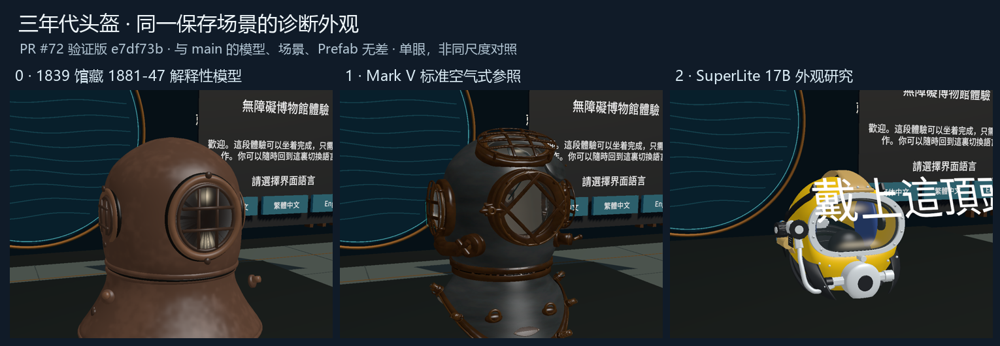

# 三年代模型的来源、资产与验收索引

2026-11-09（北京时间）。对应 [Issue #25](https://github.com/Twispra/XRmuseum/issues/25)。以 `origin/main@6088c736e89d05101e09645c1796556012a6fd5d` 为准，在 `codex/issue-25-era-review` 独立 worktree 核对。原工作区的 ProjectSettings 和未跟踪资料保留。三档均接入，默认 Mark V。1988 照片外形研究作为左台独立展品另在 #64 记录。

## 本轮必过项

| 分值 | 验收条件 |
| --- | --- |
| 35 | 三档逐项列部件、前侧背方向和可查来源，明确馆藏或厂家确认、照片观察、建模估算、待核实。 |
| 30 | 核对可编辑源、导出、Unity 使用副本、LFS 展开哈希和主场景／Prefab 绑定。 |
| 20 | 核对实际诊断画面及其源码版本，标明用途、旧证据和未测范围。 |
| 15 | 明确剩余资料、精修范围、可分派条件和目标 PC VR 验收记录。 |

四类均通过、独立复审至少 90 分且无阻断时，完成可离线执行的模型核对。真实设备、未公开馆藏资料和人工历史／外观评价单列。

## 已保存资产的实际核对

运行 `python artifacts/helmet-refinement/qa/20261109-issue25/audit-models.py --base 6088c736e89d05101e09645c1796556012a6fd5d --output <独立记录.json>`。工作区 82 个 LFS 文件逐一计算 SHA-256 并与 Git LFS OID 比对，其中 20 个在 Unity 工程内。随后 `git lfs fsck` 通过。保存的 MuseumStart 引用同一个 InspectableHelmet Prefab，年代目录默认索引 1。逐个从各档渲染器追溯 FBX 源或 MeshFilter 网格，1839 的 56 个、Mark V 的 255 个和 SuperLite 的 143 个均命中该档模型 GUID。现有 GUID、模型、Prefab 与场景的前后内容一致。 [脚本](../../artifacts/helmet-refinement/qa/20261109-issue25/audit-models.py) · [逐文件哈希、GUID 和引用](../../artifacts/helmet-refinement/qa/20261109-issue25/asset-audit.json)

| 档位 | 本轮实际检查 | 结果 |
| --- | --- | --- |
| 0 · 1839 | 直接解析交付 GLB 的 JSON chunk 与 Unity OBJ 的对象和三角面 | 两份各 56 个部件、32,832 个三角面，保存 Prefab 引用 OBJ 原 GUID。GLB 与 OBJ 的文件格式和摘要各自记录。 |
| 1 · Mark V | 对建模源、派生导出和 Unity FBX 指纹；核对保存模型 GUID | 派生运行版导出与 Unity 副本 SHA-256 完全一致。原始 FBX／GLB 与运行版作为独立层次保留。 |
| 2 · SuperLite 17B | 对 v2 建模源、派生导出和 Unity FBX 指纹；核对保存模型 GUID | 派生运行版导出与 Unity 副本 SHA-256 完全一致。独立研究分件与 v2 整盔分别追溯。 |

本轮实际检查展开文件、序列化引用和 GLB／OBJ，不重新运行模型生成、Unity 或 Blender 导入。主线的 `MuseumVR` 树与 #67 存档测试 `024d039` 相同，存档年代／热点 989/989，自然退出 0。另复核 #72 的 1131/1131 编辑器证据，其模型、场景和 Prefab 与主线无差，实体站控制范围按该候选 PR 区分。 [主线同树报告](2026-10-18-pr67-review-and-merge.md) · [#72 复审证据](https://github.com/Twispra/XRmuseum/blob/cac0a2801329c061687d6c5ecd648b7e486b26d0/docs/activity/2026-11-09-issue-61-era-demo.md)

三张截帧来自同一保存场景的 #72 被测版 `e7df73b`。图中比例取决于诊断相机，SuperLite 的近景仍可见已有台面文字叠到外形的现象。分辨部件形状以各档来源和多视角检查为准。 [原始截帧](../../artifacts/helmet-refinement/qa/20261109-issue25/source-views/) · [哈希与裁切坐标](../../artifacts/helmet-refinement/qa/20261109-issue25/visual-evidence.json) · [对应 Unity 报告](https://github.com/Twispra/XRmuseum/blob/cac0a2801329c061687d6c5ecd648b7e486b26d0/artifacts/helmet-interaction/qa/runs/20261109-issue61-era-gate/visitor-report.json)

## 部件、视角与来源对照

### 1839 早期闭式头盔与胸甲

- 参照物为 Science Museum Group 藏品 1881-47。馆方登记为 1839 年、英格兰制造，整体 465 × 460 × 417 mm。馆藏页公开一张斜前方照片，整体尺寸没有标注对应轴。用户选定馆藏参照，原建模和 Unity 接入提交保留 Git 作者 r2kh8sck4y-bot，工作记录记载 Codex 辅助查源和建模。 [馆藏 1881-47](https://collection.sciencemuseumgroup.org.uk/objects/co40614/first-closed-diving-helmet-and-breastplate) · [建模记录](2026-10-18-early-helmet-1881-47.md) · [Unity 接入 PR #69](https://github.com/Twispra/XRmuseum/pull/69)

| 观察方向 | 对照部位与证据 | 当前模型的估建和待核项 |
| --- | --- | --- |
| 正面 | 馆藏斜前方照片可辨圆顶、受护栏保护的观察窗和宽胸甲。Unity 正面窗、铜质圆顶和胸甲各有独立网格。 | 窗缘、护栏截面、紧固件与胸甲细部按照片重建，缺少零件测绘。虚拟开窗是展项交互，历史开闭机构待核。 |
| 侧面 | 同一馆照可见部分侧面轮廓及侧窗。项目保存正面和侧面模型检查图。 | 背向半侧、窗框深度、胸甲侧缘曲率及 X460/Y417/Z465 mm 的轴向分配属于模型估建。完整侧视与零件尺寸待馆藏资料。 |
| 背面 | Unity 诊断图可检查圆顶和胸甲背面，背面视角下正面观察窗受实体遮挡。 | 已引用的馆藏照未覆盖真实背面。后部接头、紧固件位置、隐蔽结构和表面状况缺少证据。 |

- 可复现资产链从 Python 生成源到交付 GLB、Unity OBJ，再由早期档绑定进入 InspectableHelmet。当前交付清单记录 56 个命名部件、32,832 个三角面。正面窗、圆顶、胸甲分别绑定到 FrontPort_Glass、Bonnet_RoundedCopper、Breastplate_DishedCopper。 [生成源](../../artifacts/helmet-modeling/early-1881-47/build_helmet.py) · [交付 GLB](../../artifacts/helmet-modeling/early-1881-47/delivery/early-1881-47.glb) · [几何清单](../../artifacts/helmet-modeling/early-1881-47/delivery/geometry-summary.json) · [运行时 OBJ](../../MuseumVR/Assets/Museum/Features/EarlyHelmet/Models/early-1881-47-runtime.obj)
- 下一次资产评审先补同一馆藏实物的完整侧照、背照，或带可辨尺寸标记的馆方记录，逐项核对后部接头、紧固位置和窗框比例。现有三视为模型诊断，戴头显时的文字可读性和交互可达性仍待 PC VR 走查。 [#61 三视诊断](https://github.com/Twispra/XRmuseum/blob/cac0a2801329c061687d6c5ecd648b7e486b26d0/artifacts/helmet-interaction/qa/runs/20261109-issue61-era-gate/front-side-rear.png)

### Mark V Mod. 1

本档外形以 Hampton Roads Naval Museum 馆藏的 1944 年 DESCO 标准空气型为参照，铭牌日期为 1944 年 12 月 1 日。同件公开照片覆盖正面及佩戴者左右侧。另一座海军博物馆的 1942 年 Morse 藏品和 DESCO 现行产品资料只用来核对同类构造与功能。建模源和运行版的原始交接分别见 #32 和 #35，沿用项目既有归属记录。[1944 年馆藏](https://hamptonroadsnavalmuseum.blogspot.com/2023/02/in-collection-mark-v-diving-helmet.html) · [海军水下博物馆 Mark V](https://navalunderseamuseum.org/mk-v/) · [DESCO 标准空气型](https://www.divedesco.com/P/162/MarkVDivingHelmet) · [项目史料笔记](../../artifacts/helmet-refinement/eras/mark-v/references/research.zh-CN.md)

| 部位与视角 | 可核验依据 | 当前模型与待核实范围 |
| --- | --- | --- |
| 正面及顶部 | 1944 馆藏文字和正面照片支持四个带护格的视窗及胸甲轮廓。DESCO 资料可交叉核对可开启的圆形前窗和椭圆顶窗。 | 正面模型保留前窗与顶窗，另有打开状态的渲染。窗框截面、铰链开角、玻璃与密封层厚度为模型估计。[正面](../../artifacts/helmet-refinement/eras/mark-v/previews/02-front.png) · [前窗打开](../../artifacts/helmet-refinement/eras/mark-v/previews/09-window-open.png) |
| 佩戴者左右侧 | 同件左右侧照片可核对侧窗及外部件轮廓。DESCO 保存的海军手册节录把排气阀标在佩戴者右侧侧窗下，出口朝后。 | 侧视图分别保留侧窗护格及可见外部件。侧件的精确偏移和配合尺寸待同件测绘核实。[左侧](../../artifacts/helmet-refinement/eras/mark-v/previews/03-wearer-left.png) · [右侧](../../artifacts/helmet-refinement/eras/mark-v/previews/04-wearer-right.png) · [排气阀说明](https://www.divedesco.com/Content/files/diveProductDownloads/MKVExhaustInstructions.pdf) |
| 背面及接头 | 海军水下博物馆的同类资料确认从背后看电话接头在左、供气接头在右。1944 年参照件的背面缺少同件正对照片。 | 模型按该类结构安排背部接口，电话杯以封闭件处理。接头间距、外壳后部曲率及电话杯的精确尺寸待同件背照或测绘核实。[背面](../../artifacts/helmet-refinement/eras/mark-v/previews/05-rear.png) · [背部接头](../../artifacts/helmet-refinement/eras/mark-v/previews/07-rear-connections.png) |
| 胸甲压条及内部 | DESCO 现行制造说明列出 11 个短紧固件与 1 个长紧固件，可用于核对类型。海军历史资料和制造说明支持内部导气通道的功能。1944 年参照件缺少同件内部照片和测绘资料。 | 模型胸甲表现 12 个紧固点，精确间距与安全锁间隙待核实。内部气道属于解释性复原，内部件走向、尺寸及材料细节待核实。[制造说明](https://www.divedesco.com/commercialdiveequipment/construction) · [胸甲压条](../../artifacts/helmet-refinement/eras/mark-v/previews/08-brail-detail.png) · [解释性内部](../../artifacts/helmet-refinement/eras/mark-v/previews/10-interior-interpretive.png) |

[Blender 源文件](../../artifacts/helmet-refinement/eras/mark-v/sources/mark-v-mod1.blend) · [GLB](../../artifacts/helmet-refinement/eras/mark-v/exports/mark-v-mod1.glb) · [原始 FBX](../../artifacts/helmet-refinement/eras/mark-v/exports/mark-v-mod1.fbx) · [运行版 FBX](../../artifacts/refined-model-integration/exports/mark-v-runtime.fbx) · [Unity 使用副本](../../MuseumVR/Assets/Museum/Features/RefinedModels/Models/mark-v-runtime.fbx) · [原运行版检查记录](../../artifacts/refined-model-integration/qa/mark-v-runtime.json) · [细化记录](../../artifacts/helmet-refinement/eras/mark-v/references/refinement-r2.zh-CN.md)

### SuperLite 17B

- 厂商产品页将 500-010 接线柱版与 500-011 防水通信接头版分列。黄色外观照及侧阀组照片可用于视觉对照，照片未建立具体序列号或后部通信配置。整盔参考整理和资产链保留 Ereshkigal1224 的署名与 Codex 辅助记录。#37、#39 是独立细节研究，#43 是整盔建模，#44 记录了 Unity 接入。 [厂商产品页](https://www.kirbymorgan.com/products/helmets/superlite-17b) · [整盔来源地图](../../artifacts/helmet-refinement/eras/superlite-17b/references/whole-helmet-source-map-v2.zh-CN.md) · [Unity 接入记录](../superlite17b-unity-integration.zh-CN.md)

| 观察方向 | 对照部位与证据 | 当前模型的估建和待核项 |
| --- | --- | --- |
| 正面 | 厂商整盔爆炸图确认黄色壳体 520-065、压环 560-070、观察窗 520-004；官方外观照可对照观察窗与壳体轮廓。 | Glass_Port_520-004 和 Shell_Yellow_520-065_ESTIMATED 对应运行时网格。展项侧开观察窗供观察，厂商爆炸图显示实物窗由紧固件固定。壳体外形、窗缘及螺孔尺寸仍属估建。 |
| 侧面 | 厂商整盔图列出侧阀总成 505-024，侧阀组详图和产品页侧照支持阀组外观及零件位置。 | 整盔采用侧轮廓 v2。独立细节研究有自己的来源和估算尺度；其尺寸和精度需按实际使用网格另行核对。现有整盔尺度约 0.282 × 0.314 × 0.325 m，是模型尺度。 |
| 背面 | 厂商整盔图确认后配重、提手、颈夹与卡箍；颈夹手册列有 510-533 氯丁橡胶颈封，通信手册区分接线柱与防水通信接头。 | Unity 的颈封网格是 NeckDam_Neoprene_510-533。现有教学语音端点不能确定实物接线柱几何或所建变体；背部走线、固定孔位及具体生产配置缺少同版本照片或测绘。 |

[厂商整盔爆炸图 241108001](https://www.kirbymorgan.com/sites/default/files/2025-01/sl-17b-blowapart-241108001.pdf) · [侧阀组详图](https://www.kirbymorgan.com/sites/default/files/2023-01/chromed-brass-side-block-blowapart-230118015.pdf) · [颈夹手册](https://www.kirbymorgan.com/sites/default/files/2026-03/superlite-17b-neck-clamp-area-including-internal-chin-strap-and-yoke-260319004.pdf) · [通信手册](https://www.kirbymorgan.com/sites/default/files/2024-07/communications-on-superLite-17b-and-17c-helmets-kmb-18-and-28-bandmasks.pdf)

- 资产链为整盔侧轮廓 v2 Blender 源、运行时 FBX 导出、Unity 同名 FBX。接入记录列出两份 FBX 相同的 SHA-256、143 个可见网格、50,268 个三角面和 14 个随前窗移动的网格。#69 已将颈封热点修到可见表面，历史内部 ID 保持为 breastplate。 [整盔 Blender 源](../../artifacts/helmet-modeling/superlite17b-2026-10-11/revision-side-profile-v2/delivery/superlite17b.blend) · [FBX 导出](../../artifacts/superlite17b-unity-integration/exports/superlite17b-v2-runtime.fbx) · [Unity FBX](../../MuseumVR/Assets/Museum/Features/SuperLiteModels/Models/superlite17b-v2-runtime.fbx) · [导出清单](../../artifacts/superlite17b-unity-integration/README.md)
- 下一次资产评审先确认目标通信配置，再用同配置背照核对后配重、颈夹和接线件的相对位置；涉及安装孔或接口尺寸时补厂商尺寸图或实测。现有三视和模拟射线用于定位观察窗、壳体和颈封；头显下的热点可达性、空间尺度和帧率仍待 PC VR 走查。 [#61 三视诊断](https://github.com/Twispra/XRmuseum/blob/cac0a2801329c061687d6c5ecd648b7e486b26d0/artifacts/helmet-interaction/qa/runs/20261109-issue61-era-gate/front-side-rear.png)

## 剩余证据及下一步

| 范围 | 待补证据与判定方式 | 交付约定 |
| --- | --- | --- |
| 1839 | 同馆藏正对侧面、背面或轴向标注尺寸。对照后部外形、观察窗和胸甲紧固处逐项更新证据类型。 | 先交可查来源和视角标注。只有证据明确改变解释时，再认领对应程序源和 Unity 派生资产。 |
| Mark V | 同一 1944 藏品的背照、内侧或测绘。核对接头间距、后壳、胸甲与密封配合。 | 沿用 #32／#35 贡献和独立历史资产。记录匹配到的具体参照件及差异，保持原操作和引用。 |
| SuperLite 17B | 以同一 500-010 配置的铭牌、视图与厂家图号核对通信、后侧附件、口盖和颈封。 | 先确认参考照片的生产版本与通信配置。记录哪些内容仍是 v2 展示假设。 |
| 目标 PC VR | 用明确构建记录 0→1→2→0，逐档检查展签、前窗与热点的简繁英、双眼可读性、遮挡、单手触达及设备帧时。重点回看 SuperLite 近距离台面文案、侧后颈封及 1839 虚拟窗。 | 附 commit、Windows 构建版本、设备、OpenXR 运行时、左右手、眼位、操作与观察位置、结果及性能数据或未测说明。核心路线和下一位访客复位在 #50 汇总，年代门控和热点问题关联 #61。 |

本轮完成现有模型的资料与运行引用审阅。新增精修由成员另行认领，写清资料、部件、文件、分支与输出。每件记录实际与模型单位、比例、轴向和原点、接口基准及尺寸来源，保存独立可编辑源，并回读 LFS 展开后的导出与 Unity 副本，记录部件、比例及连接处变化。真实头显、双眼、舒适度、性能以及需要补齐的馆藏或厂家材料保留待验。人工外观与史料复核也与自动检查分开。Codex 辅助本轮审阅、证据核对和独立评审。

## 独立复审

首轮独立复审 96/100。已补渲染器到模型的逐项校验、原始诊断帧与测试报告的定位，以及新增精修的交付条件。

最终独立复审 **100/100**。史料与部件 35/35，资产引用 30/30，诊断画面 20/20，后续交接 15/15。复审独立复跑，82 个 LFS 文件、454 个渲染器引用和审计 JSON 逐字节一致，`git lfs fsck` 通过。三张原帧与对应运行目录逐张哈希一致，按清单裁切并缩放后与对照图的三格逐像素一致。离线必过项全部通过，无阻断。已观察的 SuperLite 近景文字叠到外形仍列入 PC VR 走查。
