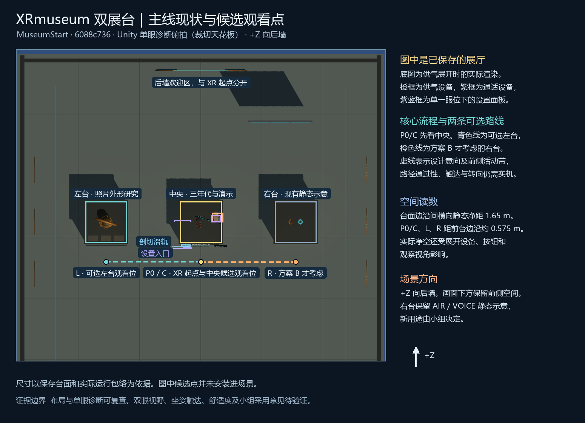

# 双展台用途与参观路径方案

2026-11-09（北京时间）。对应 [#64](https://github.com/Twispra/XRmuseum/issues/64)。方案依据为 `main@6088c736e89d05101e09645c1796556012a6fd5d` 的保存场景 `MuseumStart`，工作分支为 `codex/issue-64-plinth-options`。建议先采用方案 A 作为最小范围供小组评审。右台用途、小组意见和后续实施负责人待决定。

## 首阶段验收

| 分值 | 必需交付 |
| --- | --- |
| 30 | 可追溯的现状图。标明起点、左台、中央、右台、主要观看位置、通行范围及两类演示展开位置。区分保存对象、运行时对象和方案标注。 |
| 25 | 两种组合使用同一组比较维度。说明访客问题、与中央的关系、复用、史料边界、工作量及交互负担。 |
| 30 | 给出最小推荐和完整坐姿单手路线。逐项核对头盔、剖切轨道、设置面板和设备可能造成的遮挡、碰撞及触达问题，分开记录设计推演、模拟证据和真实设备状态。 |
| 15 | 在评审材料中列出小组决策记录字段、选择后的实施范围和依赖。实际小组决定单独保留为待决策。 |

四项均通过、独立复审至少 90 分且无阻断，才算方案交付完成。真正采用方案和写入共享场景须另有小组决定。

## 保存场景与观看位置

[保存场景透视图](../../artifacts/gallery-layout/20261109-issue64/visitor-overview.png) · [布局测量与截图来源](../../artifacts/gallery-layout/20261109-issue64/layout-evidence.json) · [保存场景](../../MuseumVR/Assets/Museum/Scenes/MuseumStart.unity)

- **P0，体验起点。** XR Origin 在地面 XZ 约 `(0, 2.20)`，面向展品 `+Z`。后侧 Welcome 说明所在区域和实际起点是两个标记。从 P0 到中央台面前缘的 XZ 差约 0.575 m，到台基前缘约 0.625 m。两项均是平面几何距离。
- **C，中央主要观看位。** 首个候选观看位与 P0 同点。三年代头盔保持主展品。外壳、实际玻璃、固定剖切轨道及年代按钮是既有入口。供气／通话设备在中央附近展开，图中的位置表示展开状态。主线基线与候选 [#61／PR #72](https://github.com/Twispra/XRmuseum/pull/72) 要分别核对。后者通过实施复审、待合并，规定只有实际显示 Mark V 时开放这两项演示。
- **L，左台可选观看位。** 左台 `Exhibit 01 - 1988 Photo Helmet Study` 已有三语展签和左转、复位、右转三个按钮。按住 Grip 后原位松开确认，移开取消。1988 取自原照片标签，馆藏身份、年代说明与尺寸仍待核实。只比较外形可见特征，例如前窗与轮廓；该展台未开放前窗、剖切、供气或通话。 [左台功能说明](../photo-helmet-unity-study.zh-CN.md) · [#67 验证与限制](2026-10-18-pr67-review-and-merge.md)
- **R，右台候选观看位。** `Exhibit 03 - Placeholder` 保留台体，旧 `Replace With Museum Exhibit` 对象停用。现有静态布置已有 “STAY CONNECTED”／“AIR / VOICE” 展示和两条造型管线。场景装饰和台体可以用于定向，目前没有独立可交互展品。 [保存场景透视图](../../artifacts/gallery-layout/20261109-issue64/visitor-overview.png)

三台中心 XZ 分别约为 `(-3.10, 3.50)`、`(0, 3.50)`、`(3.10, 3.50)`。台基宽约 1.35 m，台面宽约 1.45 m，因此相邻台基、台面静态间距分别约 1.75 m、1.65 m。候选 L 与 R 设在各台前方的 XZ `(-3.10, 2.20)` 和 `(3.10, 2.20)`，侧支线沿展台前方往返。图上通行带和观看位用于比较，设备、面板、障碍包络及 XR 移动规则可缩小实际可用区域。核心流程以中央观看位为主，侧台各自使用独立观看位。 [展厅和保存场景说明](../maritime-gallery.zh-CN.md)

### 展开与设置状态测量

在 Windows／Unity 2022.3.62f3c1 中打开保存的主场景，Play 后用既有命令设置剖切、AIR、VOICE 和设置面板的诊断状态。下表为当前状态下可见 Renderer 或线路的世界坐标包围盒投影，单位为米。

| 测量对象 | X 范围 | Z 范围 |
| --- | --- | --- |
| AIR 展开泵体 | 0.35 到 0.73 | 3.50 到 3.80 |
| AIR 展开线路 | −0.57 到 1.03 | 3.01 到 4.17 |
| VOICE 展开电话 | 0.34 到 0.64 | 3.50 到 3.73 |
| VOICE 展开线路 | −0.44 到 0.89 | 3.04 到 4.19 |
| 剖切开启时的固定轨道 | −0.65 到 −0.35 | 2.68 到 2.77 |
| 固定设置入口 | −0.59 到 −0.31 | 2.62 到 2.66 |
| 样例设置面板 | −0.87 到 −0.33 | 3.54 到 3.56 |

样例设置眼位为 `(0, 1.55, 2.15)`，面板成功显示。面板位置随唤出眼位改变。标注的 `z=2.20` 侧向路径中心线与表中采样包络在 XZ 投影上分开；AIR 主线路最靠前的采样边界为 `z≈3.01`，距该中心线约 0.81 m，伴随方向线约 0.80 m。包围盒不能覆盖设备整段旋转、不同面板落点、身体或手柄净空，也不能推断射线在三维中无遮挡。先保留 C 向两侧的候选前方路径，并实测低眼位、设备持握和设置打开时的视线及触达。 [原始布局测量](../../artifacts/gallery-layout/20261109-issue64/layout-evidence.json)

在 P0/C、L、R 上方取约 1.20 m 和 1.55 m 两个诊断眼高。C 指向中央头盔，首个实体为头盔前窗，距离约 1.14／1.17 m。L 指向左台复位，首个实体为自身按钮，约 0.68／0.74 m。R 指向台面，首个实体为自身台面，约 1.30／1.36 m。指向轨道中心的两条线分别长约 0.73／0.86 m，样例设置眼位到面板中心约 1.52 m，均未检出前置实体。结果为眼到诊断目标的单线几何探测。手柄触达、连续移动碰撞、完整视野及其他操作状态仍需逐项实测。 [样本结果](../../artifacts/gallery-layout/20261109-issue64/layout-evidence.json)

首轮测量得到运行时包络，同时发现顶视相机被顶棚遮挡，诊断场景的模拟器界面启动也需要键盘设备。复跑让诊断顶视从世界 `y=3.0 m` 以下截取，并补临时键盘和两档眼位的视线采样。布局标注、诊断相机和用于展开设备的调用只用于评估，既有场景资产保留。

复跑命令使用 Unity `-batchmode -projectPath <worktree>/MuseumVR -logFile <独立日志> -executeMethod Issue64LayoutCapture.RunBatch`。额外工程文件仅为临时 Editor 诊断脚本及其 meta，退出后两项均移出工程。20 份 Unity LFS 工作副本已核对展开哈希。进程自然退出 0，1,299 个 tracked 工程文件前后零差，无应用异常。 [诊断脚本存档](../../artifacts/gallery-layout/20261109-issue64/capture-script.cs.txt) · [退出与指纹](../../artifacts/gallery-layout/20261109-issue64/process.json)

## 方案对比

共同核心学习目标是从一次操作说出一个可见部件及其作用。拓展目标是说明供气或通话中至少一项如何依赖水面配合。比较时记录访客能否用自己的话说出一项观察结果，以及增加的读图或操作是否帮助回答拓展问题。课题验证和用户研究另行安排。

| 比较维度 | A · 左台外形对比，右台预留 | B · 左台外形对比，右台解释水面协作 |
| --- | --- | --- |
| 左右台用途 | 左台复用照片研究与旋转／复位。右台保留既有静态连接主题展签、造型管线及通行带，不添加任务。 | 左台同 A。右台将已有连接主题提示细化为一张静态三语图，区分「水面向头盔供气」和「潜水员与水面团队双向联络」，并指回中央操作。 |
| 访客问题 | 「我看到两件头盔的哪个外部特征不同？」可从前窗形状或壳体轮廓举例。 | 同一外形问题，增加「潜水员和水面团队各做什么，哪条连线是双向？」 |
| 与中央的关系 | 中央承担查看、操作和解释。可先走完中央，再向左补看和返回。 | 中央保留唯一可操作的供气／通话演示。右台只提供流程读图，允许只看中央，也允许读图后回中央验证。 |
| 史料与复用 | 复用已保存的 #67 左台资产、三语展签与控件，沿用中央说明。对比仅指可见外形。 | 复用 A 及既有供气／通话主题和中央机制。新增图只表达当前展项的概念流程，需先核实每条图示对应的演示状态；具体年代、设备及连接方式需有可查依据才写入。 |
| 文字与操作负担 | 访客只需在中央完成核心任务。左台可用一次点击补看，右台无操作步骤。 | 右台增加一处视线切换和读图，设计上控制为一张图、两条说明、一个返回提示，保持右台无新按钮和音频。 |
| 实现与检查成本 | 方案成本低，可保留现有场景。若之后补定向提示，需三语文案、视图和单手验证。 | 成本中等，增加三语图文、字形及独立展示 Prefab，需比较面板与设备的视线遮挡、布局回归及现场走查。 |
| 主要取舍 | 有更多净空，能先查清 #50 的中央流程和交接问题。右台暂不承担解说任务。 | 右台提供补充解释位置。需要控制重复信息并验证多一个观察点是否帮助理解。 |

**推荐 A 进入小组评审。** 左台已有可用的比较材料，中央可独立交代核心问题。先用 A 的短路径确认单手进入、看懂、操作和退出，再决定是否需要 B 的读图补充。B 的样图可以在独立场景或 Prefab 试排，待小组确定用途、内容来源和写入者后再评估接入。

## 坐姿单手路径

从同一把椅子完成，左右手分别走一遍。核心路线为 **P0 发现 → 同点 C 观察与操作 → C 结束**，首选直接在起点完成。可选对比为 **C → L → C**。方案 B 的额外支线为 **C → R → C**。需要虚拟转向或位移时由同一只控制器操作。图中的观看位是检查姿态，虚拟移动方式、可达距离及舒适度均待目标设备确认。

| 路段 | 访客动作与反馈 | 可回退与待查项 |
| --- | --- | --- |
| P0 → C，发现展品 | 从起点面对中央轮廓，只用一只手指向固定入口。在中央设置选择语言，需要时调整视角高度或减少动画。 | 如果起点无法触达或唤出设置，且实机已核实单控制器虚拟移动／转向，再用该路径靠近。需要另一只手、实际步行或实际转身时，记录为 [#50](https://github.com/Twispra/XRmuseum/issues/50) 的路径问题。 |
| C，观察与理解 | 单手用外壳旋转或触发玻璃，选择一处热点，说明看到了哪个部件。愿意继续时用固定滑轨观察切面。两种布局均以 Mark V 为设备讲解场景，可依次操作 AIR、关闭、VOICE、关闭。 | 默认核心路径可跳过切换年代及设备操作。用同一只手收起设置、取消误按、离开剖切或关闭展开设备，检查主视野与按钮均恢复。 |
| C → L → C，可选外形比较 | 从中央关闭演示后，再用已核实的虚拟移动或转向到 L。读左台标签、用一个按钮将模型转动一次，指出一个可见外形差异。左台用自身复位，再沿原方向回 C。 | 两只手分别验证到达、指向、原位松手和返回。如果 L 触达或虚拟导航有障碍，先从 C 完成核心任务，缺口单独记录。 |
| C → R → C，仅 B | 在 R 读两条水面协作关系，辨认哪条是双向，再沿图示提示回 C 查看中央对应演示。 | 右台图在候选阶段；若读图或返回产生额外转向负担，先跳过 R 并记录观察。 |
| C，结束与交接 | 收起展开设备、设置和剖切。如需要，分别使用中央 RESET 和 RESET VIEW。能说出一项观察结果后，用目标设备上核实的单控制器入口退出。 | 左台复位和中央复位分别作用。普通 RESET／RESET VIEW 保留发现记录，默认界面隐藏旧 NEW VISIT。单手退出与下一位清除发现记录均属 #50 实机走查。工作人员代为退出时记录为协助。 [主线复位说明](../../README.md) |

## 空间与触达核对计划

| 场景组合 | 设计／几何核对 | 实机待验 |
| --- | --- | --- |
| 起点、C、L、R，演示收起 | 对照标注图和台体边缘，沿侧向间隙核查连续地面、障碍和可候选观看位。侧支线进入前关闭设备，保留回中央的方向提示。 | 坐姿左右手各试一次。记录虚拟转向和移动可用、双眼可辨方向、是否需身体转动、到位后能否退出。 |
| C，头盔正常／开窗／剖切，滑轨两端 | 对照固定滑轨与头盔旋转范围。检查热点、滑轨两端、开窗目标和主要观看线；剖切移去的表面单独标为视图预期。 | 在左右手常用眼位确认射线落在目标、沿轨道拖动无需过伸、松开不误触其他对象。 |
| C，AIR／VOICE 分别展开与收起 | 分开核对两套设备和线路的实际展开范围。检查设备、旋转包络、线路和关闭入口是否阻断 C 视线或 C ↔ L／R 的路径。候选 #61 再查 Mark V 切档后的清理。 | 各用一只手打开、关闭和重新通过路径，记录遮挡、误触、舒适度和实际清除结果。 |
| C 与 L，设置分别唤出／收起 | 检查完整面板文字、按钮包络、视线和碰撞，沿用原型 0.35–1.60 m 阅读距离和 0.55 m 面板中心水平避让等约束。已有 #67 模拟反例与修复显示左模型曾与设置面板相交。B 若增加右台图，也须检查新包络。 | 先取约 1.20 m 和 1.55 m 两个诊断眼高，再由设备走查核对坐姿差异和偏侧视角。确认唤出可见且能关闭，收起后碰撞停用，观察是否需要过度伸手。 [面板避让规则](../operator-panel.zh-CN.md) |
| 双台展签与控制 | 左台已有三语合成输入证据。B 的新三语图需检查大小、字形、裁切、颜色含义和返回提示；信息不能只靠颜色、声音或动画表达。 | 核对双眼可读性、左右手按钮触达、轻触误按、发起取消和返回路线。人工结果附设备、运行时、版本及观察位置。 |

已知历史证据是 #67 的左台模拟射线／Direct／三语 801/801 和面板位置 271/271，来自与本次基线相同的 `MuseumVR` 树。布局图、记录中的静态距离及历史模拟分别证明场景位置和特定行为。真实头显、坐姿单手整条路线、触达、双眼可读性、舒适度和访客理解均保留待验。 [#67 精确被测版本与限制](2026-10-18-pr67-review-and-merge.md)

## 小组决定与交接

| 在 #64 记录的字段 | 当前值或填写约定 |
| --- | --- |
| 评审对象 | 本方案及同版本现状图。回复附评审日期、GitHub 账号、候选方案 A／B、具体理由与对应图号或位置。 |
| 采用结论 | **待小组决定。** 按「采用 A」「采用 B」「暂缓」「待补证后重审」选一项，保留异议与跟进事项。 |
| 决定依据 | 填写学习目标、右台用途、侧台是否为必经、尚缺的实机或来源证据、与 [#50](https://github.com/Twispra/XRmuseum/issues/50)、[#61](https://github.com/Twispra/XRmuseum/issues/61)、[#25](https://github.com/Twispra/XRmuseum/issues/25) 的关系。 |
| 采用 A 后 | 先保留现有摆设，用 #50 的版本与走查补证。若只需定向文字，先交三语文案和独立预览，再评估是否需写入场景。 |
| 采用 B 后 | 确认图文来源和独立 Prefab 范围，指定内容审查人与唯一场景整合人。待遮挡、触达、三语与动线检查后再接入。 |
| 负责人／文件／期限 | 小组填写实际负责人、整合人、修改路径、分支、依赖版本、首版时间和验收负责人。共享场景同一时段由一人写入。 |

本轮提交供比较与评审的设计材料。组内采纳、共享场景实施和实机走查分别记录。[#63](https://github.com/Twispra/XRmuseum/issues/63) 可沿用现有中央与左台信息继续准备讲解，无需等待右台决定。

## 独立复审

**97/100，四项方案验收均通过，无阻断。** 现状与证据 30/30，两方案比较 24/25，坐姿单手路线和空间检查 28/30，决策记录 15/15。复审确认场景图、九个视线样本、AIR／VOICE、轨道和面板包络均可回查。方案 B 的图文来源和定稿依小组决定。空间样本覆盖离散眼位，设备旋转完整包络、持续移动、手柄触达及双眼结果仍待实机。按复审建议进一步区分 AIR 主线与伴随方向线的近端距离。

本轮使用 Codex 辅助布局比较、取证和独立复审。右台用途仍待小组决定，方案交付完成。
