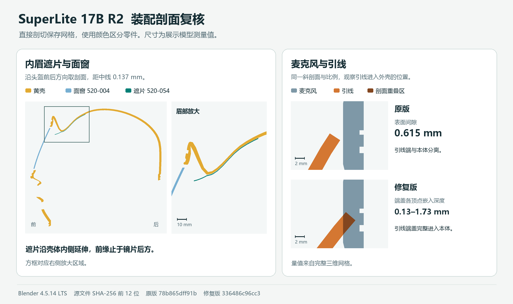

# SuperLite 17B 整盔的三项复审修复

本次更新 [PR #94](https://github.com/Twispra/XRmuseum/pull/94) 的独立展示模型，目标分支为 `codex/helmet-refinement-assets`。上一版的模型、预览和报告保存在[原始交付提交](https://github.com/Twispra/XRmuseum/tree/edfd536688fd97501010eb657ab04db1aad7a065)。[完整 Blender 源](../../artifacts/helmet-modeling/superlite17b-r2-assembly-2026-11-21/SuperLite17B-R2-assembled.blend) · [单文件 GLB](../../artifacts/helmet-modeling/superlite17b-r2-assembly-2026-11-21/SuperLite17B-R2-assembled.glb) · [整盔四视图](../../artifacts/helmet-modeling/superlite17b-r2-assembly-2026-11-21/SuperLite17B-assembly-views.png)



## 模型改动

- **内眉遮片。** 厂家把 520-054 Visor 列为第 1 项，壳体供货包含它。第 35 项是独立的 520-004 透明面窗。按厂家材料公告，新增一件深色、真空成形 ABS 的展示网格。遮片从壳内前额向眉部延伸，前缘在镜片后方。厚度、具体曲率和隐藏座面采用展示估算，原厂固定方式和尺寸缺少直接测量。[厂家分解图，第 1–2 页](https://www.kirbymorgan.com/sites/default/files/2025-01/sl-17b-blowapart-241108001.pdf) · [材料变更公告 1/1998](https://www.kirbymorgan.com/sites/default/files/Change_Product_01_98.pdf)
- **麦克风引线。** 从 515-029 麦克风的实际背面定位线端。原件最近表面间距 0.615 mm，修复版端盖 12 个顶点全部位于本体内部。端盖顶点到最近表面的局部法向深度为 0.129–1.734 mm。新验收会区别端部接入和线身中段擦过。
- **修改范围。** 从已认可的 R2 裸壳重建整盔后，在原整盔上应用经验证的引线顶点与遮片生成步骤，保留既有部件。逐件比较 172 个旧网格，有向三角、逐角 UV 和法线指纹在 171 件上相同。仅引线发生变化，另新增 1 件遮片。两张内嵌铭牌图像字节相同。首个打包候选留下 Blender 对本机重建文件的引用，独立重开后淘汰。最终遮片在原整盔内直接生成，发布源已检查外部路径、链接库及 Blender 弱引用，三者均为零。[独立复核记录](../../artifacts/helmet-interaction/qa/runs/20261121-issue25-pr94-assembly-fixes/review.json)

## 发布文件复测

以 `842c862fe8139ed8e69da0bed55e1c3fc9d50ed4` 为被测提交。Windows、Blender 4.5.14 LTS，启动复跑时没有已跟踪修改。整理交接文档期间，被测模型、导出和验收代码均与上述提交一致。本地 Python 缓存留在隔离工作区。资产以 Git LFS 保存，R2 裸壳 SHA-256 为 `800f5175684cf9a31f83344bb03c16af2a079f7e77391a27ca1b17bdbccf777e`，整盔为 `336486c96cc3accf37770a47a77b651462706258592aeb77fc5ea1ca4e74ce99`，发布 GLB 为 `82de680095b45aa24b45b523510c244488394d7f84c6f32b9674a6295885e4bb`。

| 检查 | 复测结果 |
| --- | --- |
| [保存源几何](../../artifacts/helmet-interaction/qa/runs/20261121-issue25-pr94-assembly-fixes/geometry.json) | 10/10。173 个网格、265,244 个三角面、32 种 Blender 材质。与获认可裸壳的指纹匹配。遮片专项 6/6，1,014 条指定中央视线均通畅。 |
| [装配接口](../../artifacts/helmet-interaction/qa/runs/20261121-issue25-pr94-assembly-fixes/interfaces.json) | 10/10。检查 8,281 对部件。麦克风与线端有 28 对三角相交，只有接入端的端盖完整进入本体。 |
| [直接回读发布 GLB](../../artifacts/helmet-interaction/qa/runs/20261121-issue25-pr94-assembly-fixes/glb-readback.json) | 在空场景导入已提交的同一文件，按网格、材质、三角面绕序及面角 UV 配对。265,244 个有向三角面和 795,732 组面角 UV 相符，允许合法重排和导出拆缝。两张铭牌像素与纹理映射通过。Khronos 格式检查 0 错误、0 警告。 |
| [GLB 回归反例](../../artifacts/helmet-interaction/qa/runs/20261121-issue25-pr94-assembly-fixes/glb-regressions.json) | 发布原件、合法重排及等效恒等材质变换均通过。四个反例分别是镜像铭牌面角 UV、以材质变换镜像铭牌、绑定到错误 UV 通道，以及反转 11,520 个镜片三角面的绕序，验收逐项拒绝。 |
| [独立复审及模型反例](../../artifacts/helmet-interaction/qa/runs/20261121-issue25-pr94-assembly-fixes/review.json) | 旧整盔缺遮片和引线断开均被检出。移动遮片挡住了 252 条指定视线，改成透明材质、仅让线身中段穿过麦克风也都触发相应检查。 |

独立复查在两处名义眼位各向镜片中央投射 1,346 条射线，均未遇到遮片。眼位再抬高 11 mm 后，左右各有一条样本在中央选区边缘被挡。以上为固定眼位的模型测量。真实佩戴视野、舒适性、承压或密封、Unity 运行时、设备性能和新构建均未在本轮验证。

## 复查命令

在仓库根目录运行，先展开这两份 Blender 源和发布 GLB。令 `$b` 指向 Blender 4.5.14，`$out` 指向一个新的空目录。下列四项只需要读取交付文件。

```powershell
$d = 'artifacts/helmet-modeling/superlite17b-r2-assembly-2026-11-21'
$shell = 'artifacts/helmet-modeling/superlite17b-shell-review-2026-11-21/SuperLite17B-yellow-shell-R2.blend'
$model = "$d/SuperLite17B-R2-assembled.blend"
$glb = "$d/SuperLite17B-R2-assembled.glb"
& $b -b --factory-startup --python-exit-code 2 -P "$d/check_assembly.py" -- --shell $shell --model $model --report "$out/geometry.json"
& $b -b --factory-startup --python-exit-code 2 -P "$d/check_interfaces.py" -- --model $model --report "$out/interfaces.json"
& $b -b --factory-startup --python-exit-code 2 -P "$d/export_review.py" -- --model $model --verify $glb --report "$out/glb-readback.json"
& $b -b --factory-startup --python-exit-code 2 -P "$d/check_export_regressions.py" -- --model $model --glb $glb --report "$out/glb-regressions.json"
```

合并选择留给用户。[#25](https://github.com/Twispra/XRmuseum/issues/25) 继续跟踪三年代协作及后续实机、史料工作。
