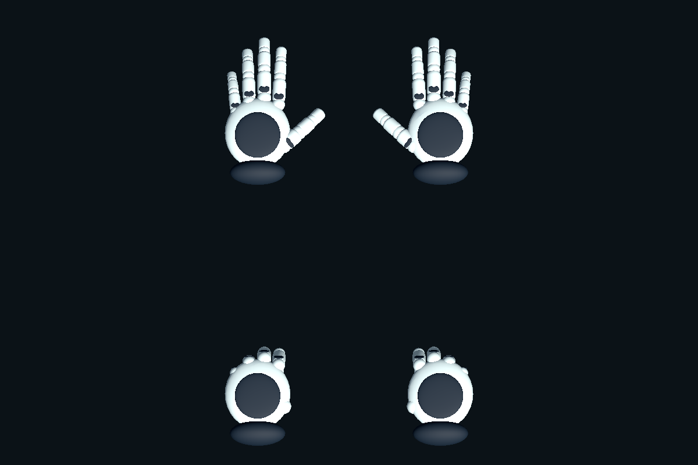

# 虚拟手、近距拿放与双手协作

本轮对应 [Issue #50](https://github.com/Twispra/XRmuseum/issues/50)，在现有 Windows PC VR / OpenXR / XRI 2.6.4 工程上加入博物馆手套与双手交互。编辑器保持 **Unity 2022.3.62f3c1**。具体被测 commit、额外未提交修改、自动验证、构建和真实头显反馈见[本轮活动记录](activity/2026-10-14-physical-hands.md)。

本轮已保存手模块与场景。首轮 Quest 3 / Virtual Desktop 反馈指出抓握空隙、难拿及左摇杆前后卡顿，已据此修订表面贴合与自身碰撞隔离；修订的验证和待测范围见[设备反馈记录](activity/2026-10-14-physical-hands-device-feedback.md)。下文操作说明不替代头显验收。

## 打开已保存的交付

- 日常体验：[MuseumStart 主场景](../MuseumVR/Assets/Museum/Scenes/MuseumStart.unity)。
- 单独检查拿放和阻挡：[PhysicalHandsLab 测试场景](../MuseumVR/Assets/Museum/Features/PhysicalHands/Scenes/PhysicalHandsLab.unity)，提供测试墙和可抓方块。
- 保存的左右手套：[LeftMuseumHand](../MuseumVR/Assets/Museum/Features/PhysicalHands/Prefabs/LeftMuseumHand.prefab)、[RightMuseumHand](../MuseumVR/Assets/Museum/Features/PhysicalHands/Prefabs/RightMuseumHand.prefab)。

接真实 PC VR 头显沿用[协作指南中的设备步骤](getting-started.zh-CN.md#接真实-pc-vr-头显)，记录头显、控制器、OpenXR runtime 和串流方式。现有相机、地面定位及输入动作继续使用原配置。打开新 clone / worktree 前须确认 LFS 模型已经展开成实际资产；不要用旧生成器修复导入问题。

Windows 候选程序的实际目录和被测版本见[活动记录](activity/2026-10-14-physical-hands.md)。移动或分享时须保留完整目录，包括 `.exe`、`MuseumVR_Data`、`UnityPlayer.dll`、`MonoBleedingEdge` 等依赖，不能只复制 exe。

Play 后，**Grip / 握持**驱动抓握并选择近处物体；松开 Grip 放下。**Trigger / 扳机**驱动食指弯曲，继续沿用已有 Activate 输入。左右手套为原创浅灰手套和海军蓝袖口，每只手有五指预设动画；输入来自控制器，不是光学手指追踪。

这是首轮候选的历史外观预览。当前持有大型头盔时改用半握的支撑姿势；真实设备的手掌对齐和双眼显示仍待复测。

## 怎样拿放和协作

1. 将手靠近头盔本体，再按住 Grip。首次近距抓握时，掌面朝模型表面贴合，物体最多在约 0.18 秒内收拢 12 cm。慢慢抬起、旋转，降低到展台后松手，观察物体是否稳定。不要求固定的左右手姿势，换手不重新吸附。
2. 另一只手靠近本体并按住 Grip，可共同支撑。只松开一只手时，另一只手继续持有；最后一只手松开才释放。可按这个顺序换手。双手操作保持原尺度，不通过两手距离缩放展品。已有一手持盔时，贴近外壳的另一手 Grip 优先接握本体，避免被外壳说明热点抢走；热点悬停与射线选择继续可用。
3. 一只手抓本体，另一只手靠近前窗并握住，沿铰链方向操作；剖面开启并显示球柄后，也可由另一手平移、转腕调切面。同一只手不能同时抓本体和部件，窗口与剖面仍互斥；对准把手时优先操作部件。
4. 部件由操作手**相对头盔**的姿态驱动。两手随头盔共同平移或转动时，部件局部状态应保持；操作手不动而持盔手移动时，两者产生的相对运动可以改变窗口或剖面。
5. 本体仍被抓住时，由 XRI 驱动其刚体。若松开最后一只抓本体的手而窗口或球柄仍被握住，展品会暂时固定，避免下落；部件松开后恢复对应物理状态。
6. 使用展台 **RESET** 或键盘 **Home** 返回。返回会取消持有和部件操作；先松开 Grip，再重新按下抓取，避免复位后立即被旧握持重新选中。

原 **FLOAT** 流程继续保留：先开启 FLOAT，拿起并调整头盔，松开后用同一只手操作窗口或剖面。具体操作见[近距离观察与可调剖面](helmet-advanced-inspection.zh-CN.md)。双手协作不是使用观察工具的前提。

## 碰撞与安全释放的实际含义

可见手会受到虚拟墙、桌面等物体阻挡。真实控制器仍由设备追踪，遇到阻挡时可能暂时与可见手分离；把真实手撤回可通行的位置，检查虚拟手是否自然恢复。虚拟碰撞**不提供真实力反馈**，也不能阻止现实中的手继续移动。

当前碰撞代理是世界空间运动学刚体和 **Box 手套包络**。张手尺寸约 **15 × 9 × 20 cm**，握手时收缩；这些是本轮原型参数。五指动画没有各自独立的物理碰撞，细长部件接近、转腕贴墙和狭小空隙需要实机检查。剖面只改变显示，原头盔物理包络仍保留，不能把被隐藏的外壳当作可穿入空间。

以下情况会触发释放并尝试在无阻挡位置重新对齐手：

- 控制器失去有效位置或旋转追踪，以及恢复追踪时。
- XR Origin 瞬移约 **40 cm 以上**，或约 **45°** 的快速转向。
- 近距持有物实际握点或手代理与追踪目标相距超过 **65 cm**。

这些阈值属于交互保护设计，仍待设备验证。保护取消同时覆盖同一只手的 Direct 和 Ray 选择，包括嵌套控制器的传送射线。追踪失效时停用查询；恢复后，近距抓取需要松开 Grip，射线需要松开它自己的 Select 输入，传送射线对应传送摇杆。**拿着头盔传送或快速转向时，物体会被释放**；不要期待它随瞬移一起保持握持。物体落到不便接近的位置时，可用 RESET 返回展台。

## 第一次头显反馈：约五分钟

先打开保存的 PhysicalHandsLab 检查手与碰撞，再在 MuseumStart 检查头盔部件和复位；使用 Windows 候选构建时直接检查主场景展台和周围墙面。每步记录“正常 / 异常 / 未测”，异常附上哪只手、动作、预期与实际结果；不用把一次目视正常扩大为完整验收通过。

| 时间 | 操作 | 观察目标 |
| --- | --- | --- |
| 0:00–0:35 | 双手放在眼前，翻掌；分别轻按 Grip、松开，再按 Trigger | 左右手方向正确，手掌与真实控制器握持位置合理；张手、握拳和食指响应自然，双眼没有明显错位 |
| 0:35–1:10 | 近距抓方块或头盔，缓慢拿起、旋转、放回 | 头盔首次抓握平滑收拢，掌面空隙合理；物体跟随稳定，松手清楚且落桌不持续抖动 |
| 1:10–1:50 | 张手、握手分别慢慢接近虚拟墙和桌面，再轻微转腕 | 可见手被挡住；不明显穿入、抖动或突然换边；注意包络与五指外观是否相符 |
| 1:50–2:15 | 解除阻挡，把手撤回开放区域，再拿放一次 | 虚拟手恢复跟随，不持续卡住或突然跳过障碍；若触发保护释放，松 Grip 后可重新抓取 |
| 2:15–2:55 | 左拿右接、右拿左接，再双手持有；依次松开两手 | 1→2→1 手过程连续，不意外缩放；一手松开不丢物，最后一手松开才释放 |
| 2:55–3:40 | 一手持盔，另一手握前窗开合；两手随头盔一起慢移；有余时检查球柄 | 不抢走本体，不意外固定持有刚体；相对操作有效，共同移动保持局部角度或切面 |
| 3:40–4:10 | 持有时触发 RESET；松 Grip，再抓；检查 FLOAT 单手替代流程 | 全部选择解除，回展台后无旧握持吸回；原观察方式仍可用 |
| 4:10–5:00 | 持物做一次传送或快速转向；松 Grip 与传送摇杆，再重抓 | 物体安全释放，不被瞬间拖过展厅；手恢复合理位置，新的握持可以开始 |

设备反馈至少包含：被测 commit、是否有额外未提交修改、头显/控制器、runtime/串流方式、站姿或坐姿、通过与失败步骤、问题复现顺序。特别记录“碰撞后手能否恢复”“换手是否跳动”“另一手开窗是否抢抓”及“保护释放是否容易理解”。此轮反馈用于修正手感；最终接入后的完整流程、性能、构建和用户学习评价仍分别记录。

## 实施结构与验证入口

独立追踪目标保存控制器姿态；`MuseumPhysicalHand` 驱动受阻挡约束的手套代理；可见手和 Direct / Poke 查询对齐代理。Direct / Poke 保留原控制器层级，在 Update、FixedUpdate 和 BeforeRender 对齐；目标姿态独立读取，避免代理位置反过来成为追踪输入。

Direct 的候选查询球覆盖固定张手包络外侧 **60 mm**。本体采用 60 mm 近距选择余量；按钮、窗口及热点保持 **25 mm** 实际接触余量，均保留实心障碍视线检查。热点的宽范围悬停不会抢走本体抓取。模块启用时，头盔、观察和探索按钮按 `ColliderVolume` 的表面距离排序；停用后还原运行时临时配置。启动前关闭模块也不运行手代理。手掌与同一 Origin 的角色胶囊按碰撞对排除，避免手挡住自己的移动；墙和桌面的阻挡仍保留。

XRI 继续独占持有物的刚体运动。`MuseumHandGrabTransformer` 负责无缩放的单手、双手及换手目标；`HelmetInspectionController.ConfigureHandCollaboration(true)` 按展品启用不同手的本体/部件协作。该开关默认关闭，未启用的独立旧演示保留原互斥行为。

| 入口 | 用途 |
| --- | --- |
| `Assets/Museum/Features/PhysicalHands/Runtime/` | 手套姿态、碰撞代理、控制器绑定和双手抓取目标 |
| `Museum > Physical Hands > Validate saved integration (synthetic Play Mode)` | 对保存主场景运行自动合成输入检查 |
| `Museum.PhysicalHands.EditorTools.MuseumPhysicalHandsValidation.RunBatch` | 同一验收的批处理入口；报告保存到独立的 `artifacts/helmet-interaction/qa/runs/` 运行目录 |
| `Museum.PhysicalHands.EditorTools.MuseumPhysicalHandsBuild.RunBatch` | 从已保存主场景生成 Windows64 Development 构建与独立报告；batch 启动使用 `-buildTarget Win64`，`MUSEUM_BUILD_OUTPUT` 可指定全新绝对 `.exe` 路径，不运行 Install |
| `Museum.PhysicalHands.EditorTools.MuseumHandDeviceSetup.RunBatch` | 开发者专用：烘焙独立模型表面缓存并检查表面接触和自身角色碰撞，会保存头盔 Prefab，须遵守共享文件单写入者规则；不作为日常预览步骤 |
| `Museum > Physical Hands > Install Saved Hand Module` | 本轮开发接入工具，创建缺失手模块并接入场景；会写资产和共享场景，仅由协调的开发者在明确范围内运行 |

日常打开、预览、设备验收使用**已保存场景和 Prefab**，无需运行 Install。已有手套资产不重建；修改既有资产须保留 `.meta` / GUID。Install 是本轮开发工具，不是日常初始化步骤，也不调用 `HelmetPrototypeSetup.Build` 等历史模型生成器。

本轮保留 Samples、Packages、ProjectSettings 和现有输入动作；共享主场景和头盔 Prefab 继续由单一整合人写入。运行验证应记录实际源码和保存资产版本，分别报告手模块检查与原拿放、窗口、剖面、热点、年代、三语及复位回归。合成输入、静态截图、真实头显、当前 Windows 构建分别是不同证据，均不得互相替代。

本轮运行代码和原创手套几何由 Codex 辅助制作；设备实测、团队决定和成员贡献按实际活动记录补充。手套包络、保护阈值和抓握姿势属于原型选择，不是 Valve 源码、历史装备参数或已验证的真实重量模拟。

贡献者更新 main 后先确认 LFS 资产展开，再直接打开已保存的 MuseumStart；不运行生成器。优先复现“左摇杆前推、松开、后推、松开”和“外壳不同侧面抓取、放下、换手”。Development Player 会在本地 `Application.persistentDataPath/PhysicalHandsDiagnostics/` 写入动作、虚拟位移和帧耗时；反馈附 commit、设备/runtime、步骤及异常时间，关联 Issue #50。采样是诊断材料，不是实机通过证明。
